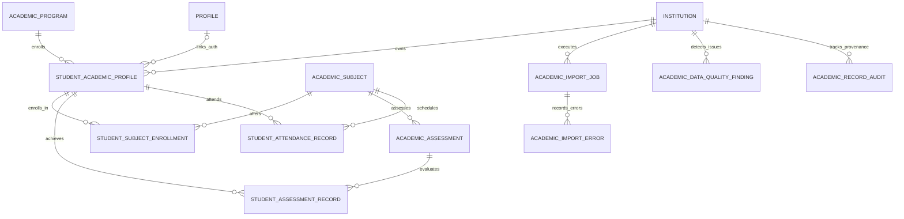

# MASTERY — Academic Data Intelligence Model

**Platform:** MASTERY — Beyond Marks. Towards Mastery.  
**Module:** Module 03: Academic Data Intelligence Hub  
**Phase:** 04/11  
**Status:** IMPLEMENTED & VERIFIED ON LIVE SUPABASE POSTGRESQL  

---

## 1. Executive Summary

The **Academic Data Intelligence Hub** serves as the verifiable, multi-tenant academic record foundation for MASTERY. It provides the structured repository of historical, ongoing, and verified academic evidence necessary for subsequent diagnostic and predictive engines (Intelligent Assessment, Learning Mastery, Academic Risk Prediction, and Career Readiness).

### Core Data Integrity Principles
1. **Multi-Tenant Isolation**: Every academic entity is strictly scoped to an `institution_id` with Foreign Key constraints and Supabase Row Level Security (RLS) enforcement.
2. **Immutable Audit Provenance**: Every insert, update, status change, and verification action is captured in `academic_record_audits` with user identity, previous/new value snapshots, and mandatory justifications.
3. **Strict Boundary Validation**: Marks cannot be negative, cannot exceed assessment `max_marks`, and preserve immutable snapshots of assessment maximum marks at the time of entry.
4. **Distinction of Absence vs Non-Performance**: Explicit statuses (`ABSENT`, `NOT_SUBMITTED`, `EXEMPTED`) prevent zero-fill bias and preserve data truth.
5. **Two-Phase Ingestion**: Uploads are staged in `academic_import_jobs`, parsed and previewed with error analysis, and only written to core tables upon user verification.

---

## 2. Entity-Relationship Overview

---

## 3. Database Schema Definitions

### 3.1 `student_academic_profiles`
Maintains the institutional academic identity and enrollment lifecycle of a student.

| Column | Type | Nullable | Constraints / Defaults | Description |
|---|---|---|---|---|
| `id` | UUID | No | PRIMARY KEY, `gen_random_uuid()` | Unique student profile identifier |
| `institution_id` | UUID | No | FK `institutions(id)` ON DELETE CASCADE | Scoped educational institution |
| `profile_id` | UUID | Yes | FK `profiles(id)` ON DELETE SET NULL | Optional link to Supabase auth user profile |
| `program_id` | UUID | Yes | FK `academic_programs(id)` ON DELETE SET NULL | Current enrolled degree program |
| `enrollment_number` | VARCHAR(100) | No | NOT NULL | Institutional roll/registration number |
| `admission_number` | VARCHAR(100) | Yes | | Institutional admission docket identifier |
| `first_name` | VARCHAR(150) | No | NOT NULL | Legal given name |
| `last_name` | VARCHAR(150) | No | NOT NULL | Legal family name |
| `email` | VARCHAR(255) | Yes | | Official or institutional contact email |
| `department` | VARCHAR(150) | No | NOT NULL | Academic branch (e.g., Computer Science) |
| `admission_year` | INTEGER | No | NOT NULL, `DEFAULT 2024` | Year student matriculated |
| `current_semester` | INTEGER | No | NOT NULL, `DEFAULT 1` | Current academic semester (1–12) |
| `academic_status` | VARCHAR(50) | No | NOT NULL, `DEFAULT 'ENROLLED'` | `ENROLLED`, `SUSPENDED`, `ALUMNI`, etc. |
| `verification_status` | VARCHAR(50) | No | `DEFAULT 'UNVERIFIED'` | `UNVERIFIED`, `FLAGGED`, `FACULTY_VERIFIED` |
| `metadata_json` | JSONB | No | `DEFAULT '{}'` | Extensible attributes, demographics |
| `created_at` | TIMESTAMPTZ | No | `DEFAULT NOW()` | Record creation timestamp |
| `updated_at` | TIMESTAMPTZ | No | `DEFAULT NOW()` | Last update timestamp |

**Table Constraints & Indexes:**
- Unique Constraint: `uq_student_inst_enrollment` on `(institution_id, enrollment_number)`.
- Index: `ix_student_profiles_inst` on `(institution_id)`.
- Index: `ix_student_profiles_enr` on `(enrollment_number)`.
- Index: `ix_student_profiles_dept` on `(department)`.
- Index: `ix_student_profiles_sem` on `(current_semester)`.

---

### 3.2 `student_subject_enrollments`
Tracks course registration per student, subject, term, and academic year.

| Column | Type | Nullable | Constraints / Defaults | Description |
|---|---|---|---|---|
| `id` | UUID | No | PRIMARY KEY, `gen_random_uuid()` | Unique enrollment identifier |
| `institution_id` | UUID | No | FK `institutions(id)` ON DELETE CASCADE | Institution scope |
| `student_id` | UUID | No | FK `student_academic_profiles(id)` ON DELETE CASCADE | Student reference |
| `subject_id` | UUID | No | FK `academic_subjects(id)` ON DELETE CASCADE | Registered subject |
| `academic_year` | VARCHAR(50) | No | NOT NULL | Academic session (e.g., `2024-2025`) |
| `semester` | INTEGER | No | NOT NULL | Semester of course offering (1–12) |
| `enrollment_status` | VARCHAR(50) | No | NOT NULL, `DEFAULT 'ACTIVE'` | `ACTIVE`, `DROPPED`, `COMPLETED` |
| `created_at` | TIMESTAMPTZ | No | `DEFAULT NOW()` | Timestamp |
| `updated_at` | TIMESTAMPTZ | No | `DEFAULT NOW()` | Timestamp |

**Table Constraints & Indexes:**
- Unique Constraint: `uq_student_sub_term` on `(student_id, subject_id, academic_year, semester)`.
- Index: `ix_subj_enr_student` on `(student_id)`.
- Index: `ix_subj_enr_subject` on `(subject_id)`.

---

### 3.3 `academic_assessments`
Defines curriculum evaluations, weightages, and grading standards.

| Column | Type | Nullable | Constraints / Defaults | Description |
|---|---|---|---|---|
| `id` | UUID | No | PRIMARY KEY, `gen_random_uuid()` | Assessment UUID |
| `institution_id` | UUID | No | FK `institutions(id)` ON DELETE CASCADE | Institution scope |
| `subject_id` | UUID | No | FK `academic_subjects(id)` ON DELETE CASCADE | Associated syllabus subject |
| `name` | VARCHAR(200) | No | NOT NULL | Name (e.g. `Mid-Term Examination 1`) |
| `assessment_type` | VARCHAR(50) | No | NOT NULL | `INTERNAL_TEST`, `MID_TERM`, `ASSIGNMENT`, etc. |
| `max_marks` | NUMERIC(6,2) | No | NOT NULL | Maximum achievable marks |
| `passing_marks` | NUMERIC(6,2) | Yes | | Benchmark minimum passing marks |
| `weightage_percentage` | NUMERIC(5,2) | Yes | | Weight in final subject grading |
| `academic_year` | VARCHAR(50) | No | NOT NULL | Academic session |
| `semester` | INTEGER | No | NOT NULL | Semester of assessment |
| `assessment_date` | DATE | Yes | | Date examination was held |
| `created_at` | TIMESTAMPTZ | No | `DEFAULT NOW()` | Timestamp |
| `updated_at` | TIMESTAMPTZ | No | `DEFAULT NOW()` | Timestamp |

**Table Constraints & Indexes:**
- Check: `ck_asmt_max_marks` (`max_marks > 0`).
- Check: `ck_asmt_weightage` (`weightage_percentage >= 0 AND weightage_percentage <= 100`).
- Index: `ix_academic_asmts_subject` on `(subject_id)`.

---

### 3.4 `student_assessment_records`
Atomic assessment scores with score snapshots and non-numeric states.

| Column | Type | Nullable | Constraints / Defaults | Description |
|---|---|---|---|---|
| `id` | UUID | No | PRIMARY KEY, `gen_random_uuid()` | Record UUID |
| `institution_id` | UUID | No | FK `institutions(id)` ON DELETE CASCADE | Institution scope |
| `assessment_id` | UUID | No | FK `academic_assessments(id)` ON DELETE CASCADE | Assessment definition |
| `student_id` | UUID | No | FK `student_academic_profiles(id)` ON DELETE CASCADE | Student evaluated |
| `marks_obtained` | NUMERIC(6,2) | Yes | | Marks obtained (null if absent) |
| `max_marks_snapshot` | NUMERIC(6,2) | No | NOT NULL | Immutable snapshot of `asmt.max_marks` |
| `result_status` | VARCHAR(50) | No | NOT NULL, `DEFAULT 'PASSED'` | `PASSED`, `FAILED`, `ABSENT`, `NOT_SUBMITTED`, `EXEMPTED` |
| `verification_status` | VARCHAR(50) | No | NOT NULL, `DEFAULT 'UNVERIFIED'` | `UNVERIFIED`, `FLAGGED`, `FACULTY_VERIFIED` |
| `verified_by_user_id` | UUID | Yes | FK `profiles(id)` ON DELETE SET NULL | Faculty identity who verified marks |
| `verified_at` | TIMESTAMPTZ | Yes | | Verification timestamp |
| `evaluation_remarks` | TEXT | Yes | | Faculty remarks, notes |
| `created_at` | TIMESTAMPTZ | No | `DEFAULT NOW()` | Timestamp |
| `updated_at` | TIMESTAMPTZ | No | `DEFAULT NOW()` | Timestamp |

**Table Constraints & Indexes:**
- Unique Constraint: `uq_student_assessment` on `(assessment_id, student_id)`.
- Check: `ck_marks_range` (`marks_obtained IS NULL OR (marks_obtained >= 0 AND marks_obtained <= max_marks_snapshot)`).
- Index: `ix_asmt_records_student` on `(student_id)`.
- Index: `ix_asmt_records_asmt` on `(assessment_id)`.
- Index: `ix_asmt_records_status` on `(result_status)`.

---

### 3.5 `student_attendance_records`
Session-level attendance observations.

| Column | Type | Nullable | Constraints / Defaults | Description |
|---|---|---|---|---|
| `id` | UUID | No | PRIMARY KEY, `gen_random_uuid()` | Record UUID |
| `institution_id` | UUID | No | FK `institutions(id)` ON DELETE CASCADE | Institution scope |
| `student_id` | UUID | No | FK `student_academic_profiles(id)` ON DELETE CASCADE | Student reference |
| `subject_id` | UUID | No | FK `academic_subjects(id)` ON DELETE CASCADE | Subject of lecture/lab |
| `session_date` | DATE | No | NOT NULL | Date of session |
| `session_name` | VARCHAR(150) | No | NOT NULL, `DEFAULT 'Lecture'` | Period/session identifier |
| `status` | VARCHAR(50) | No | NOT NULL | `PRESENT`, `ABSENT`, `LATE`, `EXCUSED`, `NOT_RECORDED` |
| `minutes_attended` | INTEGER | Yes | | Exact duration attended |
| `remarks` | TEXT | Yes | | Faculty/medical notes |
| `created_at` | TIMESTAMPTZ | No | `DEFAULT NOW()` | Timestamp |
| `updated_at` | TIMESTAMPTZ | No | `DEFAULT NOW()` | Timestamp |

**Table Constraints & Indexes:**
- Unique Constraint: `uq_student_attendance_session` on `(student_id, subject_id, session_date, session_name)`.
- Index: `ix_attendance_student_date` on `(student_id, session_date)`.
- Index: `ix_attendance_subject_date` on `(subject_id, session_date)`.

---

### 3.6 Ingestion, Auditing & Quality Models
- **`academic_import_jobs`**: Captures batch file uploads (CSV, XLSX), parsing phase, valid/invalid row counts, confirmation state, and failure logs.
- **`academic_import_errors`**: Row-by-row error logs detailing file row number, erroneous field, received raw value, and descriptive error message.
- **`academic_data_quality_findings`**: Automated anomaly and integrity scan results (`CRITICAL`, `ERROR`, `WARNING`, `INFO`) tracking rule violations, affected entity IDs, and remediation instructions.
- **`academic_record_audits`**: Append-only compliance log capturing entity changes, old/new data diffs in JSONB, triggering actor user ID, client IP, and mandatory change rationale.

---

## 4. Row Level Security (RLS) Verification
All 24 tables in the Supabase schema enforce Row Level Security (`rowsecurity = true`).
Policies ensure:
1. `SUPER_ADMIN` can inspect and manage records across all tenants.
2. `INSTITUTION_ADMIN` has full access strictly restricted to their assigned `institution_id`.
3. `FACULTY` can read student records, define assessments, submit marks, record attendance, and verify records within their institution.
4. `STUDENT` users are restricted to read-only access strictly matching their linked `profile_id`.
