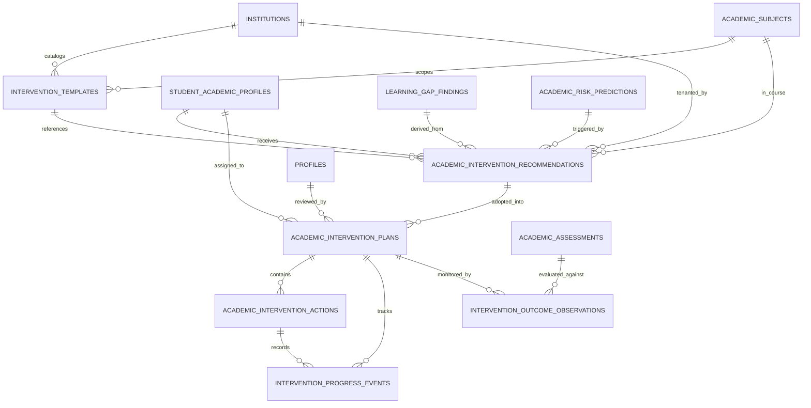

# Module 07: Personalized Academic Intervention — Data Model Specification

**Platform:** MASTERY — Beyond Marks. Towards Mastery.  
**Team:** VARY — SRUJAN 2026  
**Problem Statement:** AI-03 — Student Performance Prediction  
**Track:** AI, CyberSecurity and Digital Trust  
**Phase:** 08/11  
**Module:** 07 — Personalized Academic Intervention Engine  

---

## 1. Architectural Overview & Design Principles

The **Personalized Academic Intervention Engine** (Module 07) bridges the diagnostic insights of Phase 05 (Assessments), Phase 06 (Mastery Analytics), and Phase 07 (Academic Risk Prediction) into structured, actionable, and human-in-the-loop support pathways:

1. **Evidence-Backed Attribution:** Interventions link directly to verified learning gap findings (`learning_gap_findings`), unassessed syllabus topics (`topic_mastery_results`), or early warning predictive risk factors (`academic_risk_predictions`).
2. **Human-in-the-Loop Authority:** Automated engine outputs are treated as draft recommendations (`academic_intervention_recommendations`) and require explicit faculty review before being assigned as official student plans (`academic_intervention_plans`).
3. **Measurable Action Units:** Plans are decomposed into discrete, auditable action tasks (`academic_intervention_actions`) with estimated effort, instructions, submission artifacts, and faculty verification.
4. **Append-Only Progress Audit:** Every state transition across plans and actions generates immutable chronological event records (`intervention_progress_events`).
5. **Non-Causal Outcome Observation:** Subsequent assessment marks are recorded as empirical observational follow-ups (`intervention_outcome_observations`) without unsupported causal claims.

---

## 2. Entity-Relationship Architecture

---

## 3. Detailed Table Specifications

### 3.1 `intervention_templates`
Institutional catalog of approved intervention blueprints.

| Column | Type | Constraints | Description |
| :--- | :--- | :--- | :--- |
| `id` | `UUID` | `PRIMARY KEY, DEFAULT gen_random_uuid()` | Unique template ID |
| `institution_id` | `UUID` | `NOT NULL, FK -> institutions(id)` | Multi-tenant tenant ID |
| `subject_id` | `UUID` | `NULLABLE, FK -> academic_subjects(id)` | Course scope (NULL = multi-course) |
| `template_code` | `VARCHAR(64)` | `NOT NULL` | Unique code (e.g., `TPL_TOPIC_REVISION`) |
| `template_name` | `VARCHAR(255)` | `NOT NULL` | Human-readable title |
| `intervention_type` | `VARCHAR(50)` | `NOT NULL, DEFAULT 'TARGETED_REVISION'` | Category enum |
| `description` | `TEXT` | `NULLABLE` | Blueprint description |
| `target_level` | `VARCHAR(30)` | `NOT NULL, DEFAULT 'TOPIC'` | `TOPIC`, `UNIT`, `CLO`, `SUBJECT` |
| `suggested_duration_hours`| `FLOAT` | `NOT NULL, DEFAULT 2.0` | Estimated student effort |
| `suggested_completion_days`| `INTEGER` | `NOT NULL, DEFAULT 7` | Suggested turnaround days |
| `recommended_actions_template`| `JSONB`| `NOT NULL, DEFAULT '[]'::jsonb` | Pre-configured task blueprints |
| `required_resources` | `JSONB` | `NOT NULL, DEFAULT '[]'::jsonb` | Textbook / reading references |
| `expected_evidence_type` | `VARCHAR(100)`| `NULLABLE` | Expected artifact type |
| `requires_faculty_review` | `BOOLEAN` | `NOT NULL, DEFAULT TRUE` | Governance checkpoint flag |
| `is_active` | `BOOLEAN` | `NOT NULL, DEFAULT TRUE` | Active catalog flag |
| `created_by_profile_id` | `UUID` | `NULLABLE, FK -> profiles(id)` | Authoring faculty profile |
| `created_at` | `TIMESTAMPTZ` | `NOT NULL, DEFAULT now()` | Creation timestamp |
| `updated_at` | `TIMESTAMPTZ` | `NOT NULL, DEFAULT now()` | Last update timestamp |

**Constraints:**
- `uq_intervention_template_inst_code`: `UNIQUE (institution_id, template_code)`
- `ix_intervention_templates_institution_id`: `INDEX (institution_id)`
- `ix_intervention_templates_subject_id`: `INDEX (subject_id)`

---

### 3.2 `academic_intervention_recommendations`
Evidence-grounded candidate recommendations produced by the recommendation engine.

| Column | Type | Constraints | Description |
| :--- | :--- | :--- | :--- |
| `id` | `UUID` | `PRIMARY KEY, DEFAULT gen_random_uuid()` | Unique recommendation ID |
| `institution_id` | `UUID` | `NOT NULL, FK -> institutions(id)` | Multi-tenant tenant ID |
| `student_id` | `UUID` | `NOT NULL, FK -> student_academic_profiles(id)` | Evaluated student |
| `subject_id` | `UUID` | `NOT NULL, FK -> academic_subjects(id)` | Scoped course |
| `topic_id` | `UUID` | `NULLABLE, FK -> syllabus_topics(id)` | Targeted syllabus topic |
| `learning_outcome_id` | `UUID` | `NULLABLE, FK -> learning_outcomes(id)` | Targeted CLO |
| `risk_prediction_id` | `UUID` | `NULLABLE, FK -> academic_risk_predictions(id)`| Upstream risk signal |
| `learning_gap_id` | `UUID` | `NULLABLE, FK -> learning_gap_findings(id)` | Upstream topic gap |
| `template_id` | `UUID` | `NULLABLE, FK -> intervention_templates(id)` | Blueprint template used |
| `recommendation_type` | `VARCHAR(50)` | `NOT NULL, DEFAULT 'TARGETED_REVISION'` | Category enum |
| `priority` | `VARCHAR(20)` | `NOT NULL, DEFAULT 'MEDIUM'` | `CRITICAL`, `HIGH`, `MEDIUM`, `LOW` |
| `rationale` | `TEXT` | `NOT NULL` | Objective evidentiary rationale |
| `source_evidence_summary` | `JSONB` | `NOT NULL, DEFAULT '{}'::jsonb` | Evidentiary trace metadata |
| `evidence_sufficiency` | `VARCHAR(30)` | `NOT NULL, DEFAULT 'MODERATE'` | Sufficiency tier |
| `proposed_action_title`| `VARCHAR(255)`| `NOT NULL` | Suggested task title |
| `proposed_action_description`| `TEXT` | `NOT NULL` | Detailed pedagogical action |
| `suggested_duration_days`| `INTEGER` | `NOT NULL, DEFAULT 7` | Turnaround window |
| `status` | `VARCHAR(30)` | `NOT NULL, DEFAULT 'ACTIVE'` | `ACTIVE`, `ADOPTED_IN_PLAN`, `DISMISSED` |
| `scientific_disclaimer` | `TEXT` | `NOT NULL` | Mandatory human-in-the-loop notice |
| `created_at` | `TIMESTAMPTZ` | `NOT NULL, DEFAULT now()` | Recommendation timestamp |
| `updated_at` | `TIMESTAMPTZ` | `NOT NULL, DEFAULT now()` | Last update timestamp |

---

### 3.3 `academic_intervention_plans`
Structured, faculty-reviewed academic support plan assigned to a student.

| Column | Type | Constraints | Description |
| :--- | :--- | :--- | :--- |
| `id` | `UUID` | `PRIMARY KEY, DEFAULT gen_random_uuid()` | Unique plan ID |
| `institution_id` | `UUID` | `NOT NULL, FK -> institutions(id)` | Multi-tenant tenant ID |
| `student_id` | `UUID` | `NOT NULL, FK -> student_academic_profiles(id)` | Assigned student |
| `subject_id` | `UUID` | `NOT NULL, FK -> academic_subjects(id)` | Subject context |
| `topic_id` | `UUID` | `NULLABLE, FK -> syllabus_topics(id)` | Targeted topic |
| `learning_outcome_id` | `UUID` | `NULLABLE, FK -> learning_outcomes(id)` | Targeted CLO |
| `recommendation_id` | `UUID` | `NULLABLE, FK -> academic_intervention_recommendations(id)` | Linked recommendation |
| `plan_title` | `VARCHAR(255)`| `NOT NULL` | Plan title |
| `learning_objective` | `TEXT` | `NOT NULL` | Core conceptual objective |
| `plan_status` | `VARCHAR(30)` | `NOT NULL, DEFAULT 'DRAFT'` | State machine enum |
| `assigned_faculty_id` | `UUID` | `NULLABLE, FK -> profiles(id)` | Responsible faculty advisor |
| `reviewed_by_faculty_id`| `UUID` | `NULLABLE, FK -> profiles(id)` | Faculty who approved/rejected |
| `reviewed_at` | `TIMESTAMPTZ` | `NULLABLE` | Review timestamp |
| `faculty_review_notes` | `TEXT` | `NULLABLE` | Checkpoint feedback |
| `start_date` | `TIMESTAMPTZ` | `NULLABLE` | Activation timestamp |
| `target_completion_date`| `TIMESTAMPTZ`| `NULLABLE` | Target due date |
| `actual_completion_date`| `TIMESTAMPTZ`| `NULLABLE` | Completion timestamp |
| `expected_outcome_evidence`| `TEXT` | `NULLABLE` | Required demonstration |
| `scientific_disclaimer` | `TEXT` | `NOT NULL` | Human-in-the-loop disclaimer |
| `created_at` | `TIMESTAMPTZ` | `NOT NULL, DEFAULT now()` | Creation timestamp |
| `updated_at` | `TIMESTAMPTZ` | `NOT NULL, DEFAULT now()` | Last update timestamp |

---

### 3.4 `academic_intervention_actions`
Individual actionable tasks within an intervention plan.

| Column | Type | Constraints | Description |
| :--- | :--- | :--- | :--- |
| `id` | `UUID` | `PRIMARY KEY, DEFAULT gen_random_uuid()` | Unique action ID |
| `institution_id` | `UUID` | `NOT NULL, FK -> institutions(id)` | Multi-tenant tenant ID |
| `plan_id` | `UUID` | `NOT NULL, FK -> academic_intervention_plans(id)` | Parent plan |
| `action_order` | `INTEGER` | `NOT NULL, DEFAULT 1` | Sequential order |
| `action_title` | `VARCHAR(255)`| `NOT NULL` | Action title |
| `action_type` | `VARCHAR(50)` | `NOT NULL, DEFAULT 'TARGETED_REVISION'` | Category enum |
| `instructions` | `TEXT` | `NOT NULL` | Student instructions |
| `resource_references` | `JSONB` | `NOT NULL, DEFAULT '[]'::jsonb` | Resource links/materials |
| `estimated_effort_hours`| `FLOAT` | `NOT NULL, DEFAULT 1.0` | Effort in hours |
| `due_date` | `TIMESTAMPTZ` | `NULLABLE` | Action deadline |
| `action_status` | `VARCHAR(30)` | `NOT NULL, DEFAULT 'PROPOSED'` | Action lifecycle state |
| `student_completion_notes`| `TEXT` | `NULLABLE` | Student submission summary |
| `student_submission_url` | `VARCHAR(512)`| `NULLABLE` | Solution repository or document |
| `submitted_at` | `TIMESTAMPTZ` | `NULLABLE` | Submission timestamp |
| `faculty_feedback` | `TEXT` | `NULLABLE` | Faculty review remarks |
| `verified_by_faculty_id` | `UUID` | `NULLABLE, FK -> profiles(id)` | Verifying instructor |
| `verified_at` | `TIMESTAMPTZ` | `NULLABLE` | Verification timestamp |
| `created_at` | `TIMESTAMPTZ` | `NOT NULL, DEFAULT now()` | Creation timestamp |
| `updated_at` | `TIMESTAMPTZ` | `NOT NULL, DEFAULT now()` | Last update timestamp |

---

### 3.5 `intervention_progress_events`
Append-only chronological audit ledger for all plan and action status changes.

| Column | Type | Constraints | Description |
| :--- | :--- | :--- | :--- |
| `id` | `UUID` | `PRIMARY KEY, DEFAULT gen_random_uuid()` | Unique event ID |
| `institution_id` | `UUID` | `NOT NULL, FK -> institutions(id)` | Multi-tenant tenant ID |
| `plan_id` | `UUID` | `NOT NULL, FK -> academic_intervention_plans(id)` | Associated plan |
| `action_id` | `UUID` | `NULLABLE, FK -> academic_intervention_actions(id)`| Associated action |
| `actor_profile_id` | `UUID` | `NULLABLE, FK -> profiles(id)` | User executing transition |
| `event_type` | `VARCHAR(50)` | `NOT NULL` | Lifecycle event code |
| `previous_status` | `VARCHAR(30)` | `NULLABLE` | State before change |
| `new_status` | `VARCHAR(30)` | `NOT NULL` | State after change |
| `event_notes` | `TEXT` | `NULLABLE` | Audit justification notes |
| `event_metadata` | `JSONB` | `NOT NULL, DEFAULT '{}'::jsonb` | Contextual payload |
| `created_at` | `TIMESTAMPTZ` | `NOT NULL, DEFAULT now()` | Event timestamp |

---

### 3.6 `intervention_outcome_observations`
Post-intervention observational evidence linking subsequent assessment or mastery results.

| Column | Type | Constraints | Description |
| :--- | :--- | :--- | :--- |
| `id` | `UUID` | `PRIMARY KEY, DEFAULT gen_random_uuid()` | Unique observation ID |
| `institution_id` | `UUID` | `NOT NULL, FK -> institutions(id)` | Multi-tenant tenant ID |
| `plan_id` | `UUID` | `NOT NULL, FK -> academic_intervention_plans(id)` | Completed plan |
| `student_id` | `UUID` | `NOT NULL, FK -> student_academic_profiles(id)` | Student profile |
| `subject_id` | `UUID` | `NOT NULL, FK -> academic_subjects(id)` | Subject context |
| `topic_id` | `UUID` | `NULLABLE, FK -> syllabus_topics(id)` | Topic evaluated |
| `learning_outcome_id` | `UUID` | `NULLABLE, FK -> learning_outcomes(id)` | CLO evaluated |
| `baseline_mastery_percentage`| `FLOAT` | `NULLABLE` | Score before intervention |
| `followup_assessment_id`| `UUID` | `NULLABLE, FK -> academic_assessments(id)`| Subsequent test |
| `followup_score_obtained`| `FLOAT` | `NULLABLE` | Follow-up score |
| `followup_maximum_marks`| `FLOAT` | `NULLABLE` | Follow-up max marks |
| `followup_mastery_percentage`| `FLOAT` | `NULLABLE` | Calculated follow-up % |
| `observation_notes` | `TEXT` | `NULLABLE` | Empirical observation notes |
| `scientific_disclaimer`| `TEXT` | `NOT NULL` | Non-causal governance disclaimer |
| `observed_at` | `TIMESTAMPTZ` | `NOT NULL, DEFAULT now()` | Observation timestamp |
| `created_at` | `TIMESTAMPTZ` | `NOT NULL, DEFAULT now()` | Record creation timestamp |
