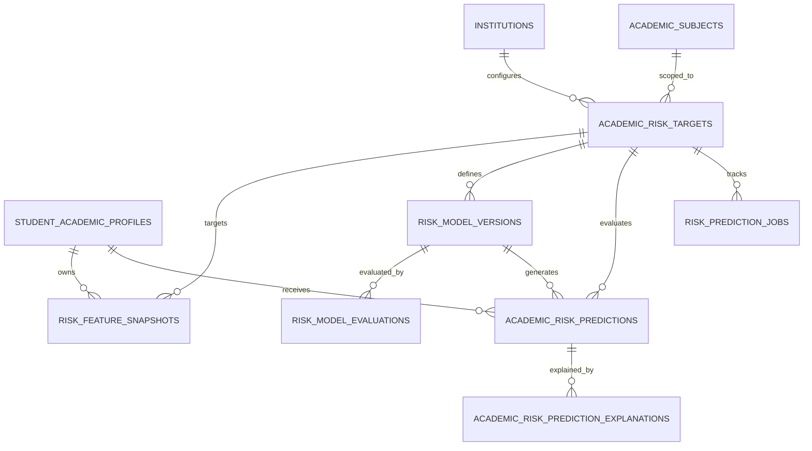

# Module 06: Academic Risk Prediction — Data Model Specification

**Platform:** MASTERY — Beyond Marks. Towards Mastery.  
**Team:** VARY — SRUJAN 2026  
**Problem Statement:** AI-03 — Student Performance Prediction  
**Track:** AI, CyberSecurity and Digital Trust  
**Phase:** 07/11  
**Module:** Academic Risk Prediction Engine

---

## 1. Architectural Overview & Design Principles

The **Academic Risk Prediction Engine** (Module 06) is grounded upon empirical, time-bounded academic evidence gathered from preceding platform modules:
- Module 02: AI Syllabus & Competency Intelligence (`syllabus_units`, `syllabus_topics`)
- Module 03: Academic Data Intelligence Hub (`student_academic_profiles`, `student_subject_enrollments`, `student_assessment_records`, `student_attendance_records`)
- Module 04: Intelligent Assessment & Attentiveness Engine (`academic_assessments`, `student_assessment_attempts`)
- Module 05: Learning Mastery & Performance Analytics (`topic_mastery_results`, `learning_gap_findings`)

The data architecture adheres to four non-negotiable engineering principles:
1. **Strict Temporal Integrity:** Feature vectors are generated strictly prior to an explicit observation cutoff date (`cutoff_date`). Any record timestamped after the cutoff is barred to prevent temporal leakage.
2. **Target Isolation & Anti-Leakage:** Final examination marks and end-of-term evaluations are quarantined as target variables and cannot be consumed by feature generation.
3. **Transparent Model Registry & Auditing:** Machine learning and deterministic rule models are tracked in versioned registries with hyperparameters, evaluation matrices, and sample provenance.
4. **Grounded Explainability:** Risk predictions map directly to verifiable academic records (continuous assessment deficits, verified attendance drops, unresolved curriculum gaps).

---

## 2. Entity-Relationship Architecture

---

## 3. Detailed Table Specifications

### 3.1 `academic_risk_targets`
Defines institutional academic risk definitions, target classification policies, passing thresholds, and prediction horizons.

| Column | Type | Constraints | Description |
| :--- | :--- | :--- | :--- |
| `id` | `UUID` | `PRIMARY KEY, DEFAULT gen_random_uuid()` | Unique risk target identifier |
| `institution_id` | `UUID` | `NOT NULL, FK -> institutions(id)` | Multi-tenant institutional partition |
| `subject_id` | `UUID` | `NOT NULL, FK -> academic_subjects(id)` | Subject context for the target |
| `target_code` | `VARCHAR(64)` | `NOT NULL` | Unique code (e.g., `MIDTERM_DEFICIT_40`, `FINAL_FAIL_50`) |
| `target_name` | `VARCHAR(255)` | `NOT NULL` | Human-readable target name |
| `outcome_definition` | `TEXT` | `NOT NULL` | Formal outcome criteria (e.g. final score < 50%) |
| `positive_label_definition` | `TEXT` | `NOT NULL` | Criteria for "At-Risk" classification (Label = 1) |
| `negative_label_definition` | `TEXT` | `NOT NULL` | Criteria for "Passed/On-Track" (Label = 0) |
| `passing_threshold_percentage` | `FLOAT` | `NOT NULL, DEFAULT 50.0` | Institutional minimum passing threshold |
| `prediction_horizon_weeks` | `INTEGER` | `NOT NULL, DEFAULT 4` | Horizon before final milestone |
| `is_institution_policy` | `BOOLEAN` | `NOT NULL, DEFAULT FALSE` | Flag for mandated institutional baseline policies |
| `status` | `VARCHAR(32)` | `NOT NULL, DEFAULT 'ACTIVE'` | Target status (`ACTIVE`, `ARCHIVED`, `DRAFT`) |
| `created_at` | `TIMESTAMPTZ` | `NOT NULL, DEFAULT now()` | Target registration timestamp |
| `updated_at` | `TIMESTAMPTZ` | `NOT NULL, DEFAULT now()` | Last update timestamp |

**Indexes & Constraints:**
- `uq_risk_target_inst_subj_code`: `UNIQUE (institution_id, subject_id, target_code)`
- `ix_risk_targets_subject_status`: `INDEX (subject_id, status)`

---

### 3.2 `risk_feature_snapshots`
Time-bounded snapshot of calculated academic feature vectors.

| Column | Type | Constraints | Description |
| :--- | :--- | :--- | :--- |
| `id` | `UUID` | `PRIMARY KEY, DEFAULT gen_random_uuid()` | Unique snapshot identifier |
| `institution_id` | `UUID` | `NOT NULL, FK -> institutions(id)` | Multi-tenant tenant ID |
| `student_id` | `UUID` | `NOT NULL, FK -> student_academic_profiles(id)` | Evaluated student |
| `subject_id` | `UUID` | `NOT NULL, FK -> academic_subjects(id)` | Course subject context |
| `target_id` | `UUID` | `NULLABLE, FK -> academic_risk_targets(id)` | Associated risk target if customized |
| `observation_cutoff_date` | `TIMESTAMPTZ` | `NOT NULL` | Exact temporal boundary for feature ingestion |
| `feature_vector_json` | `JSONB` | `NOT NULL` | 12 standardized numerical feature dimensions |
| `data_provenance_json` | `JSONB` | `NOT NULL` | Record IDs, timestamps, and row counts examined |
| `created_at` | `TIMESTAMPTZ` | `NOT NULL, DEFAULT now()` | Snapshot creation timestamp |

**Indexes & Constraints:**
- `uq_risk_feature_snap_stud_subj_cutoff`: `UNIQUE (student_id, subject_id, observation_cutoff_date)`
- `ix_risk_snapshots_inst_cutoff`: `INDEX (institution_id, observation_cutoff_date)`

---

### 3.3 `risk_model_versions`
Institutional model registry storing trained machine learning algorithms and deterministic rule baselines.

| Column | Type | Constraints | Description |
| :--- | :--- | :--- | :--- |
| `id` | `UUID` | `PRIMARY KEY, DEFAULT gen_random_uuid()` | Unique model version identifier |
| `institution_id` | `UUID` | `NOT NULL, FK -> institutions(id)` | Institutional owner |
| `target_id` | `UUID` | `NOT NULL, FK -> academic_risk_targets(id)` | Target variable this model was fitted on |
| `version_tag` | `VARCHAR(64)` | `NOT NULL` | Semantic version string (e.g. `logreg-v1.0-fall2026`) |
| `model_type` | `VARCHAR(32)` | `NOT NULL` | `LOGISTIC_REGRESSION`, `DECISION_TREE`, `DETERMINISTIC_RULES` |
| `algorithm_name` | `VARCHAR(128)` | `NOT NULL` | Underlying algorithm name |
| `training_cutoff_date` | `TIMESTAMPTZ` | `NOT NULL` | Slicing cutoff date applied to training records |
| `training_sample_count` | `INTEGER` | `NOT NULL, DEFAULT 0` | Total samples in training partition |
| `positive_sample_count` | `INTEGER` | `NOT NULL, DEFAULT 0` | At-risk instances in training set |
| `negative_sample_count` | `INTEGER` | `NOT NULL, DEFAULT 0` | On-track instances in training set |
| `feature_names` | `JSONB` | `NOT NULL` | Ordered list of consumed feature keys |
| `hyperparameters_json` | `JSONB` | `NOT NULL, DEFAULT '{}'` | Algorithm hyperparameters (`C`, `max_depth`, etc.) |
| `parameters_json` | `JSONB` | `NOT NULL, DEFAULT '{}'` | Fitted coefficients, intercepts, or rule matrices |
| `model_artifact_path` | `VARCHAR(512)` | `NULLABLE` | Local or object storage reference for serialized weights |
| `is_active` | `BOOLEAN` | `NOT NULL, DEFAULT FALSE` | Flag for active production inference model |
| `model_status` | `VARCHAR(32)` | `NOT NULL, DEFAULT 'TRAINED'` | Lifecycle status |
| `trained_by_profile_id`| `UUID` | `NULLABLE, FK -> profiles(id)` | Author/faculty who executed training |
| `created_at` | `TIMESTAMPTZ` | `NOT NULL, DEFAULT now()` | Model registration timestamp |

---

### 3.4 `risk_model_evaluations`
Quantitative validation benchmarks and evaluation metrics computed over cross-validation splits.

| Column | Type | Constraints | Description |
| :--- | :--- | :--- | :--- |
| `id` | `UUID` | `PRIMARY KEY, DEFAULT gen_random_uuid()` | Unique evaluation record ID |
| `institution_id` | `UUID` | `NOT NULL, FK -> institutions(id)` | Institution ID |
| `model_version_id` | `UUID` | `NOT NULL, FK -> risk_model_versions(id)` | Evaluated model |
| `evaluation_type` | `VARCHAR(32)` | `NOT NULL` | `CROSS_VALIDATION`, `HOLDOUT_TEST`, `BOOTSTRAP` |
| `sample_size` | `INTEGER` | `NOT NULL` | Number of evaluated instances |
| `accuracy` | `FLOAT` | `NULLABLE` | Overall prediction accuracy |
| `precision` | `FLOAT` | `NULLABLE` | Precision on at-risk positive class |
| `recall` | `FLOAT` | `NULLABLE` | Sensitivity / recall on at-risk class |
| `f1_score` | `FLOAT` | `NULLABLE` | Harmonic mean of precision and recall |
| `roc_auc` | `FLOAT` | `NULLABLE` | Area under the ROC curve |
| `brier_score` | `FLOAT` | `NULLABLE` | Probability calibration Brier score |
| `confusion_matrix_json`| `JSONB` | `NOT NULL, DEFAULT '{}'` | `{"tp": X, "fp": Y, "tn": Z, "fn": W}` |
| `evaluation_metadata` | `JSONB` | `NOT NULL, DEFAULT '{}'` | Split parameters and random seeds |
| `created_at` | `TIMESTAMPTZ` | `NOT NULL, DEFAULT now()` | Evaluation timestamp |

---

### 3.5 `academic_risk_predictions`
Individual student inference predictions evaluated against a target policy.

| Column | Type | Constraints | Description |
| :--- | :--- | :--- | :--- |
| `id` | `UUID` | `PRIMARY KEY, DEFAULT gen_random_uuid()` | Unique prediction identifier |
| `institution_id` | `UUID` | `NOT NULL, FK -> institutions(id)` | Multi-tenant tenant ID |
| `target_id` | `UUID` | `NOT NULL, FK -> academic_risk_targets(id)` | Evaluated risk target |
| `model_version_id` | `UUID` | `NOT NULL, FK -> risk_model_versions(id)` | Model generating inference |
| `student_id` | `UUID` | `NOT NULL, FK -> student_academic_profiles(id)` | Flagged student |
| `subject_id` | `UUID` | `NOT NULL, FK -> academic_subjects(id)` | Subject context |
| `cutoff_date` | `TIMESTAMPTZ` | `NOT NULL` | Observation boundary timestamp |
| `risk_score` | `FLOAT` | `NULLABLE` | Calibrated probability $[0.0, 1.0]$ |
| `risk_classification` | `VARCHAR(32)` | `NOT NULL` | `CRITICAL`, `HIGH`, `MODERATE`, `LOW`, `INSUFFICIENT_EVIDENCE` |
| `evidence_sufficiency` | `VARCHAR(32)` | `NOT NULL` | `INSUFFICIENT`, `LIMITED`, `MODERATE`, `STRONG` |
| `prediction_status` | `VARCHAR(32)` | `NOT NULL, DEFAULT 'ACTIVE'` | Lifecycle status |
| `scientific_disclaimer` | `TEXT` | `NOT NULL` | Mandatory disclaimer preserving student dignity |
| `created_at` | `TIMESTAMPTZ` | `NOT NULL, DEFAULT now()` | Inference generation timestamp |

---

### 3.6 `academic_risk_prediction_explanations`
Grounded explanatory attributions and directional feature contributions.

| Column | Type | Constraints | Description |
| :--- | :--- | :--- | :--- |
| `id` | `UUID` | `PRIMARY KEY, DEFAULT gen_random_uuid()` | Unique explanation ID |
| `prediction_id` | `UUID` | `NOT NULL, FK -> academic_risk_predictions(id)` | Associated prediction |
| `feature_name` | `VARCHAR(64)` | `NOT NULL` | Name of contributing feature |
| `feature_value` | `FLOAT` | `NOT NULL` | Student's actual numeric value |
| `contribution_weight` | `FLOAT` | `NOT NULL` | Normalized attribution score |
| `explanation_text` | `TEXT` | `NOT NULL` | Transparent, non-judgmental explanation |
| `source_evidence_reference` | `VARCHAR(255)` | `NOT NULL` | Provenance trace (e.g. `Phase 04 Assessments`) |
| `is_adverse_factor` | `BOOLEAN` | `NOT NULL, DEFAULT FALSE` | Flag indicating increased risk contribution |
| `created_at` | `TIMESTAMPTZ` | `NOT NULL, DEFAULT now()` | Record creation timestamp |

---

### 3.7 `risk_prediction_jobs`
Batch execution audit trail for asynchronous cohort inference and screening.

| Column | Type | Constraints | Description |
| :--- | :--- | :--- | :--- |
| `id` | `UUID` | `PRIMARY KEY, DEFAULT gen_random_uuid()` | Unique job identifier |
| `institution_id` | `UUID` | `NOT NULL, FK -> institutions(id)` | Multi-tenant tenant ID |
| `subject_id` | `UUID` | `NOT NULL, FK -> academic_subjects(id)` | Scoped subject |
| `target_id` | `UUID` | `NOT NULL, FK -> academic_risk_targets(id)` | Evaluated target |
| `model_version_id` | `UUID` | `NULLABLE, FK -> risk_model_versions(id)` | Model used for batch screening |
| `job_type` | `VARCHAR(32)` | `NOT NULL, DEFAULT 'BATCH_INFERENCE'` | `BATCH_INFERENCE`, `MODEL_TRAINING`, `DATASET_AUDIT` |
| `status` | `VARCHAR(32)` | `NOT NULL, DEFAULT 'PENDING'` | `PENDING`, `IN_PROGRESS`, `COMPLETED`, `FAILED` |
| `total_students` | `INTEGER` | `NOT NULL, DEFAULT 0` | Enrolled candidates in cohort |
| `processed_students` | `INTEGER` | `NOT NULL, DEFAULT 0` | Successfully evaluated candidates |
| `high_risk_detected_count`| `INTEGER` | `NOT NULL, DEFAULT 0` | Number of HIGH or CRITICAL predictions |
| `error_summary` | `TEXT` | `NULLABLE` | Execution error trace if failed |
| `created_at` | `TIMESTAMPTZ` | `NOT NULL, DEFAULT now()` | Job submission timestamp |
| `completed_at` | `TIMESTAMPTZ` | `NULLABLE` | Job completion timestamp |
