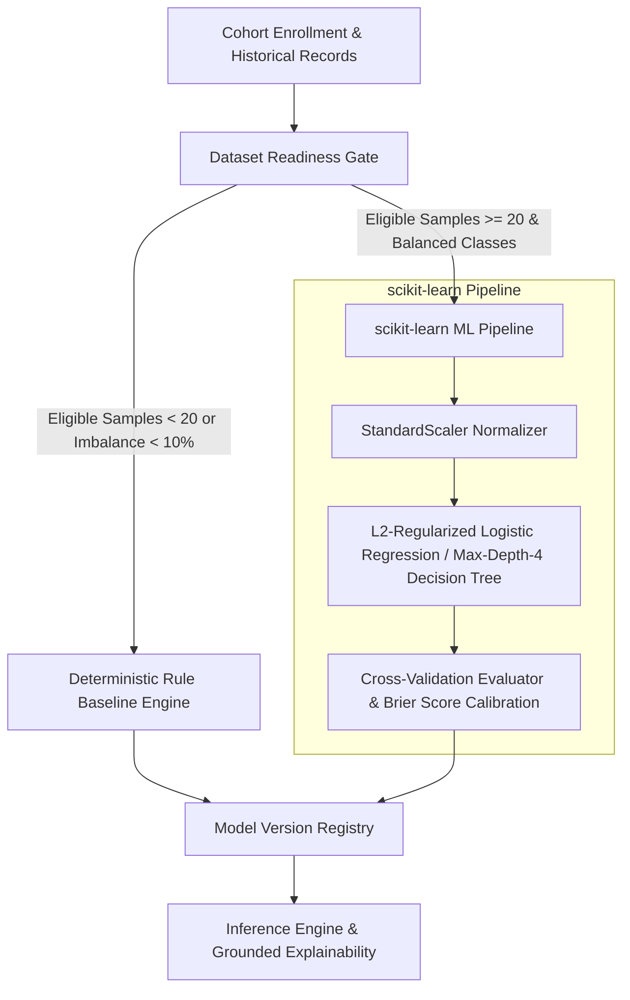

# Module 06: Academic Risk Model Design, Architecture & Training Pipeline

**Platform:** MASTERY — Beyond Marks. Towards Mastery.  
**Team:** VARY — SRUJAN 2026  
**Problem Statement:** AI-03 — Student Performance Prediction  
**Track:** AI, CyberSecurity and Digital Trust  
**Phase:** 07/11  
**Module:** Academic Risk Prediction Engine

---

## 1. Machine Learning Pipeline Architecture

MASTERY implements a disciplined, production-grade statistical and machine learning pipeline using `scikit-learn`.



---

## 2. Model Family Specifications

### 2.1 Deterministic Rule Baseline (`DETERMINISTIC_RULES`)
The foundation of the MASTERY prediction hierarchy. When labeled training data is insufficient (early semester cohorts, small elective classes, or newly introduced curriculum subjects), the system activates a deterministic expert-rules baseline.

- **Objective:** Provide robust, completely deterministic early warning screening without hallucinated ML probabilities.
- **Rule Weight Distribution:**
  1. *Rule 1 (Continuous Deficit):* If $\text{Continuous Assessment Average} < 40.0\%$, weight $+0.40$.
  2. *Rule 2 (Critical Learning Gaps):* If $\text{High Severity Learning Gaps} \ge 2$, weight $+0.30$.
  3. *Rule 3 (Attendance Deficit):* If $\text{Verified Attendance Rate} < 75.0\%$, weight $+0.20$.
  4. *Rule 4 (Curriculum Blindspots):* If $\text{Unassessed Topics} \ge 3$, weight $+0.10$.
  5. *Rule 5 (Protective Buffer):* If $\text{Continuous Assessment Average} \ge 70.0\%$, weight $-0.30$.
- **Score Calculation:** $\text{Risk Score} = \min(1.0, \max(0.0, \sum w_i))$.

### 2.2 L2-Regularized Logistic Regression (`LOGISTIC_REGRESSION`)
The primary probabilistic classifier for cohorts with sufficient validated historical outcomes.

- **Formulation:**
  $$P(y = 1 \mid \mathbf{x}) = \frac{1}{1 + e^{-(\mathbf{w}^T \mathbf{x} + b)}}$$
- **Regularization:** L2 Ridge penalty with inverse regularization strength $C = 1.0$ to prevent overfitting on collinear academic features.
- **Preprocessing:** All continuous features are normalized with standard score scaling:
  $$z = \frac{x - \mu}{\sigma}$$
- **Explainability:** Feature attribution is directly computed from learned weights:
  $$\text{Contribution}_j = w_j \cdot z_j$$
  Positive contributions indicate adverse risk drivers, while negative contributions represent protective academic habits.

### 2.3 Depth-Constrained Decision Tree (`DECISION_TREE`)
Alternative tree-based model for non-linear feature interactions (e.g. low attendance compounding severe topic gaps).

- **Hyperparameters:** `max_depth = 4`, `min_samples_split = 5`, `criterion = 'gini'`.
- **Explainability:** Decision paths are extracted as human-readable propositional rules (e.g. `If Continuous Avg <= 42.5 AND Unresolved Gaps > 1 -> Risk Tier HIGH`).

---

## 3. Dataset Readiness Gate (`inspect_dataset_readiness`)

To prevent deploying machine learning models on trivial, biased, or heavily imbalanced sample sizes, every training request undergoes a strict mathematical audit:

```python
# Minimum Institutional Readiness Criteria
MIN_LABELED_SAMPLES = 20
MIN_CLASS_INSTANCES = 5
MIN_MINORITY_RATIO = 0.10  # 10% minority representation
```

### Readiness Evaluation Flow:
1. Examine all enrolled students in the subject with historical target labels.
2. If total labeled samples $< 20$:
   - Set `is_dataset_ready_for_training = False`.
   - Add audit note: `"Insufficient training samples (X / 20 required)."`
   - Auto-fallback recommendation: `recommended_model_type = 'DETERMINISTIC_RULES'`.
3. If at-risk positive samples $< 5$ or on-track negative samples $< 5$:
   - Set `is_dataset_ready_for_training = False`.
   - Add audit note: `"Severe class imbalance detected. Less than 5 positive samples."`
   - Auto-fallback recommendation: `recommended_model_type = 'DETERMINISTIC_RULES'`.
4. If training is forced on an unready dataset:
   - The training service automatically fits a deterministic rule baseline and logs `readiness_notes` directly into `RiskModelVersion.parameters_json`.

---

## 4. Hyperparameter Tracking & Model Artifacts

Model parameters, standardizer statistics, and version tags are serialized into `risk_model_versions`:
```json
{
  "intercept": -0.421,
  "coefficients": {
    "continuous_assessment_average": -0.852,
    "topic_mastery_ratio": -0.614,
    "high_severity_learning_gap_count": 0.531,
    "verified_attendance_percentage": -0.320,
    "unassessed_topic_count": 0.218
  },
  "scaler_means": {
    "continuous_assessment_average": 64.2,
    "topic_mastery_ratio": 0.58
  },
  "scaler_scales": {
    "continuous_assessment_average": 15.3,
    "topic_mastery_ratio": 0.22
  }
}
```
This architecture eliminates unversioned black-box pickle files and guarantees complete transparency and reproducibility across database backups.
