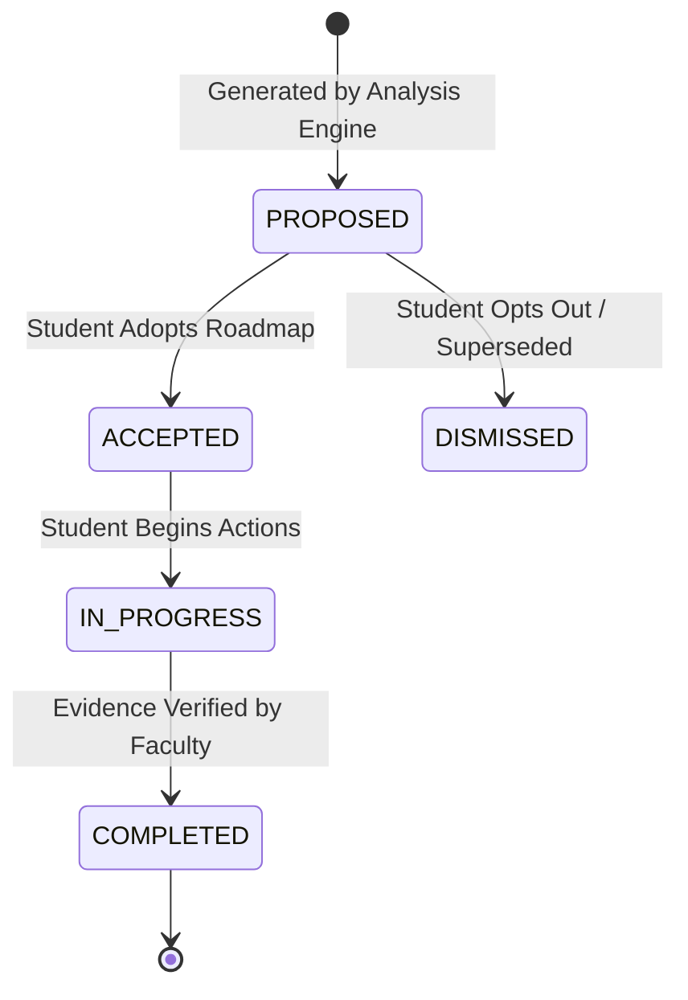

# MASTERY — Career Development Recommendations
## Actionable Growth Roadmaps and Decoupled Lifecycle Governance

**Platform:** MASTERY — Beyond Marks. Towards Mastery.  
**Module:** Module 08 — Career Readiness & Industry Skill Gap Intelligence  

---

## 1. Recommendation Philosophy

Career development recommendations transform identified skill gaps into concrete, student-executable learning roadmaps. 

### Decoupling from Academic Interventions (Phase 08)
Academic interventions in Phase 08 address formal course remediation, institutional risk mitigation, and continuous assessment gradebook deficits (`DRAFT` $\rightarrow$ `ACTIVE` $\rightarrow$ `COMPLETED`).
Career development recommendations, by contrast:
- Focus on practical engineering competencies, portfolio artifacts, and industry benchmarks.
- Are voluntary, self-directed, or placement-guided.
- Maintain their own distinct lifecycle (`PROPOSED` $\rightarrow$ `ACCEPTED` $\rightarrow$ `IN_PROGRESS` $\rightarrow$ `COMPLETED`).
- **Optional Linkage:** When a career skill gap is directly rooted in an academic subject failure, a recommendation may maintain an optional `academic_intervention_plan_id` reference without conflating the execution states.

---

## 2. Recommendation Types

| Recommendation Type | Typical Focus | Expected Demonstration Evidence |
|---|---|---|
| **`DSA_PRACTICE`** | Algorithmic optimization, time/space trade-offs | Completed problem sequence on benchmark topics. |
| **`PRACTICAL_PROJECT`** | Full-stack architecture, microservices, APIs | Verified public repository with README, tests, and CI. |
| **`DATABASE_EXERCISE`** | Schema design, indexing, SQL optimization | Evaluated lab submission or schema migration script. |
| **`SYSTEM_DESIGN`** | High-availability design, caching, queues | Architectural diagram and technical design doc. |
| **`CODE_LAB`** | Concurrency, thread safety, low-level execution | Executable test cases passing automated checks. |
| **`TECHNICAL_DOCUMENTATION`** | API specifications, architectural proposals | Published OpenAPI documentation or engineering RFC. |
| **`FACULTY_CONSULTATION`** | Curriculum mapping review or thesis guidance | Faculty sign-off log. |

---

## 3. Lifecycle Transitions

