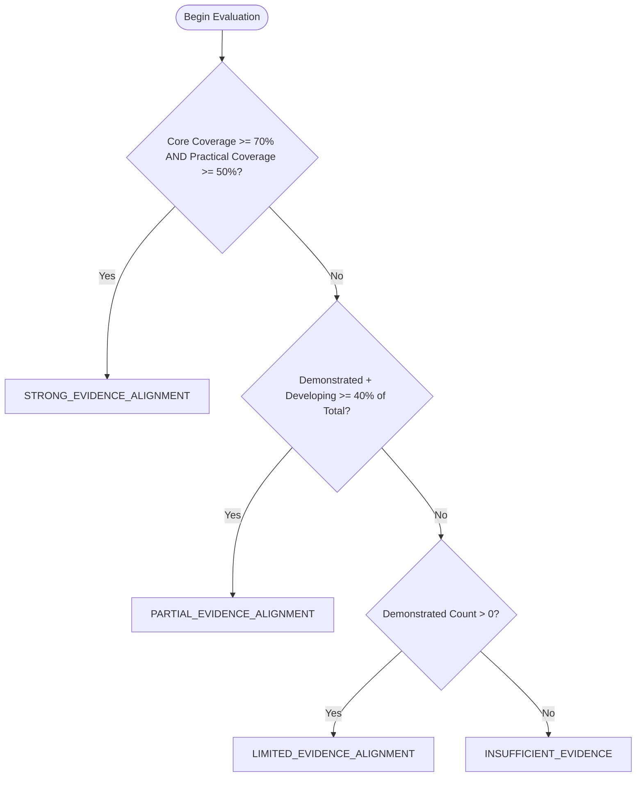

# MASTERY — Career Readiness Evaluation Algorithm
## Deterministic, Role-Specific Competency Alignment & Non-Aggregation Policy

**Platform:** MASTERY — Beyond Marks. Towards Mastery.  
**Module:** Module 08 — Career Readiness & Industry Skill Gap Intelligence  

---

## 1. Algorithmic Principles

1. **Role Specificity:** A student is never labeled generically "employable" or "unemployable". A student may exhibit `STRONG_EVIDENCE_ALIGNMENT` for Web Development while exhibiting `INSUFFICIENT_EVIDENCE` for Machine Learning.
2. **Non-Aggregation Standard:** We strictly reject collapsing technical skills, soft skills, attendance, and grades into a single composite percentage (e.g., "78% Job Ready"). Such numbers hide critical single points of failure (e.g. inability to design an SQL schema despite high multiple-choice test scores).
3. **Decoupled Intelligence:** Career readiness is independently evaluated from semester GPA and Phase 07 academic risk predictions.

---

## 2. Mathematical & Classification Logic

For a given student $s$ and target role profile $R$:

### 2.1 Coverage Metrics

$$\text{Core Competency Coverage (\%)} = \frac{\sum_{r \in \text{Core}(R)} \mathbb{I}(e_{s,r} \in \{\text{DEMONSTRATED}, \text{DEVELOPING}\})}{|\text{Core}(R)|} \times 100$$

$$\text{Practical Evidence Coverage (\%)} = \frac{\sum_{r \in \text{Practical}(R)} \mathbb{I}(\text{has\_verified\_project}(s,r))}{|\text{Practical}(R)|} \times 100$$

Where:
- $\text{Core}(R)$ is the subset of requirements with importance `CORE` or `HIGH`.
- $\text{Practical}(R)$ is the subset of requirements with category `PROGRAMMING`, `PRACTICAL`, or `TOOLS_TECHNOLOGIES`.
- $\mathbb{I}(\cdot)$ is the indicator function.

---

### 2.2 Alignment Classification Decision Tree

### Classification Definitions:
1. **`STRONG_EVIDENCE_ALIGNMENT`:** Comprehensive alignment with core expectations and demonstrated practical artifacts.
2. **`PARTIAL_EVIDENCE_ALIGNMENT`:** Solid foundation with emerging capabilities; requires targeted gap remediation in remaining competencies.
3. **`LIMITED_EVIDENCE_ALIGNMENT`:** Isolated demonstrated competencies present, but core occupation foundation remains incomplete.
4. **`INSUFFICIENT_EVIDENCE`:** Majority of benchmarked requirements have not been assessed or verified.

---

## 3. Mandatory Ethical Disclaimer

Every generated readiness report embeds the following non-negotiable disclaimer:

> *"Career readiness evaluations reflect observed alignment between demonstrated academic, assessment, and verified practical project evidence against curated industry role competency profiles. This evaluation describes current evidence availability and development recommendations, and does NOT constitute a guarantee of employment, hiring prediction, or singular employability score."*
