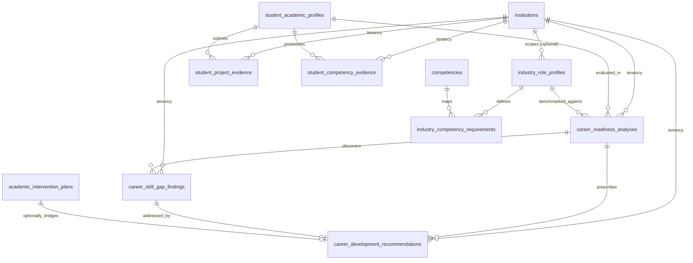

# MASTERY — Career Readiness Data Model
## Entity-Relationship Specifications for Module 08

**Platform:** MASTERY — Beyond Marks. Towards Mastery.  
**Phase:** 09/11  
**Module:** Career Readiness & Industry Skill Gap Intelligence  

---

## 1. Architectural Overview

The Career Readiness data model bridges student academic and practical assessment evidence with curated professional role frameworks. In accordance with MASTERY's core philosophy:
- **No Arbitrary Composite Scores:** The database does not store or calculate an overall singular employability percentage.
- **Traceable Evidence Provenance:** Competencies must trace to explicit source evaluations (continuous assessments, topic masteries, or verified projects).
- **Placement Officer Isolation:** Foreign keys and RLS policies guarantee placement personnel cannot access Phase 07 academic risk models or Phase 08 internal interventions.

---

## 2. Table Specifications

### 2.1 `industry_role_profiles`
Represents curated professional occupation profiles (e.g. SDE Backend, Web Developer, Data Engineer).

| Column | Type | Constraints | Description |
|---|---|---|---|
| `id` | UUID | PRIMARY KEY | Unique role identifier |
| `institution_id` | UUID | NULLABLE, FK `institutions(id)` | NULL for global platform roles, UUID for institutional |
| `role_title` | VARCHAR(255) | NOT NULL, INDEX | Descriptive title (e.g., Software Development Engineer) |
| `role_family` | VARCHAR(100) | NOT NULL, INDEX | Category (e.g., Software Development, Data & AI) |
| `description` | TEXT | NOT NULL | Role scope and competency narrative |
| `experience_tier`| VARCHAR(50) | NOT NULL | Default "Entry-Level / Fresher" |
| `version` | VARCHAR(50) | NOT NULL | Semantic versioning of requirements (default "1.0") |
| `is_active` | BOOLEAN | NOT NULL | Activation status |
| `review_status` | VARCHAR(50) | NOT NULL | Default "APPROVED" |
| `created_at` | TIMESTAMPTZ | NOT NULL | Audit creation timestamp |
| `updated_at` | TIMESTAMPTZ | NOT NULL | Audit update timestamp |

### 2.2 `industry_competency_requirements`
Relates roles to specific competencies with required depth and priority tiers.

| Column | Type | Constraints | Description |
|---|---|---|---|
| `id` | UUID | PRIMARY KEY | Requirement identifier |
| `role_id` | UUID | NOT NULL, FK `industry_role_profiles(id)` | Target role |
| `competency_id` | UUID | NULLABLE, FK `competencies(id)` | Linked academic competency |
| `competency_name`| VARCHAR(255) | NOT NULL | Competency title |
| `category` | VARCHAR(50) | NOT NULL | PROGRAMMING, ANALYTICAL, TOOLS_TECHNOLOGIES, PRACTICAL |
| `required_depth` | INTEGER | NOT NULL | Required Bloom/proficiency level (1 to 5) |
| `importance` | VARCHAR(50) | NOT NULL | CORE, IMPORTANT, SUPPORTING, OPTIONAL |
| `mapping_status` | VARCHAR(50) | NOT NULL | APPROVED, AI_SUGGESTED, FACULTY_REVIEW_REQUIRED |
| `source_reference`| VARCHAR(255) | NULLABLE | Industry benchmark citation (NASSCOM, IEEE, ACM) |
| `rationale` | TEXT | NULLABLE | Justification for requirement |

### 2.3 `student_project_evidence`
Tracks student-submitted practical software projects and portfolios.

| Column | Type | Constraints | Description |
|---|---|---|---|
| `id` | UUID | PRIMARY KEY | Project submission identifier |
| `institution_id` | UUID | NOT NULL, FK `institutions(id)` | Institutional tenant |
| `student_id` | UUID | NOT NULL, FK `student_academic_profiles(id)` | Student creator |
| `title` | VARCHAR(255) | NOT NULL | Project title |
| `description` | TEXT | NOT NULL | Architecture, problem solved |
| `technology_stack`| JSON | NOT NULL | List of technologies used |
| `repository_url` | VARCHAR(512) | NULLABLE | GitHub, GitLab repository URL |
| `portfolio_url` | VARCHAR(512) | NULLABLE | Live deployment or demo link |
| `demonstrated_competencies` | JSON | NOT NULL | Declared competency list |
| `verification_status` | VARCHAR(50) | NOT NULL | PENDING_REVIEW, VERIFIED, REJECTED |
| `reviewer_id` | UUID | NULLABLE, FK `profiles(id)` | Faculty verifier |
| `reviewed_at` | TIMESTAMPTZ | NULLABLE | Timestamp of faculty review |
| `verification_notes` | TEXT | NULLABLE | Faculty evaluation feedback |

### 2.4 `student_competency_evidence`
Unified evidence ledger recording student competency states across evaluations.

| Column | Type | Constraints | Description |
|---|---|---|---|
| `id` | UUID | PRIMARY KEY | Evidence ledger entry |
| `institution_id` | UUID | NOT NULL, FK `institutions(id)` | Tenant reference |
| `student_id` | UUID | NOT NULL, FK `student_academic_profiles(id)` | Target student |
| `competency_id` | UUID | NULLABLE, FK `competencies(id)` | Academic competency |
| `competency_name`| VARCHAR(255) | NOT NULL, INDEX | Standardized competency label |
| `category` | VARCHAR(50) | NOT NULL | PROGRAMMING, PRACTICAL, etc. |
| `evidence_type` | VARCHAR(50) | NOT NULL | ASSESSMENT, TOPIC_MASTERY, PROJECT, etc. |
| `source_entity_type`| VARCHAR(50) | NOT NULL | Underlying entity model |
| `source_entity_id`| UUID | NULLABLE | FK to assessment response or project |
| `evidence_state` | VARCHAR(50) | NOT NULL, INDEX | DEMONSTRATED, DEVELOPING, INSUFFICIENT_EVIDENCE |
| `score_or_metric`| FLOAT | NULLABLE | Numerical score (0-100) |
| `evidence_summary`| TEXT | NOT NULL | Human-readable evidence explanation |
| `provenance_details`| JSON | NULLABLE | Contextual metadata |
| `verified_by` | UUID | NULLABLE, FK `profiles(id)` | Reviewer profile |
| `is_eligible` | BOOLEAN | NOT NULL | Exclusion flag for disqualified evidence |

### 2.5 `career_readiness_analyses`
Role-specific readiness evaluation records containing non-aggregated coverage metrics.

| Column | Type | Constraints | Description |
|---|---|---|---|
| `id` | UUID | PRIMARY KEY | Analysis record identifier |
| `institution_id` | UUID | NOT NULL, FK `institutions(id)` | Tenant reference |
| `student_id` | UUID | NOT NULL, FK `student_academic_profiles(id)` | Evaluated student |
| `role_id` | UUID | NOT NULL, FK `industry_role_profiles(id)` | Target role benchmark |
| `alignment_status`| VARCHAR(50) | NOT NULL, INDEX | STRONG, PARTIAL, LIMITED, INSUFFICIENT |
| `total_requirements_count` | INT | NOT NULL | Number of benchmark requirements |
| `demonstrated_count` | INT | NOT NULL | Requirements with demonstrated evidence |
| `developing_count` | INT | NOT NULL | Requirements with developing evidence |
| `core_competency_coverage` | FLOAT | NOT NULL | Percentage of core requirements met (0-100) |
| `practical_evidence_coverage`| FLOAT | NOT NULL | Percentage of practical requirements met (0-100) |
| `summary_rationale` | TEXT | NOT NULL | Evidence-grounded interpretation |
| `disclaimer` | TEXT | NOT NULL | Mandatory non-employability disclaimer |

### 2.6 `career_skill_gap_findings`
Discovered competency gaps categorized into 5 distinct types.

| Column | Type | Constraints | Description |
|---|---|---|---|
| `id` | UUID | PRIMARY KEY | Gap identifier |
| `analysis_id` | UUID | NOT NULL, FK `career_readiness_analyses(id)` | Parent analysis |
| `student_id` | UUID | NOT NULL, FK `student_academic_profiles(id)` | Student |
| `role_id` | UUID | NOT NULL, FK `industry_role_profiles(id)` | Role benchmark |
| `competency_name`| VARCHAR(255) | NOT NULL | Target competency |
| `gap_type` | VARCHAR(50) | NOT NULL, INDEX | DEMONSTRATED, EVIDENCE, CURRICULUM, PRACTICAL, MAPPING |
| `gap_severity` | VARCHAR(50) | NOT NULL, INDEX | CRITICAL, HIGH, MODERATE, LOW |
| `rationale` | TEXT | NOT NULL | Detailed reason for gap |
| `suggested_action`| TEXT | NOT NULL | Prescribed activity |
| `evidence_needed` | TEXT | NOT NULL | Criteria for clearing gap |

### 2.7 `career_development_recommendations`
Personalized roadmap items addressing identified skill gaps.

| Column | Type | Constraints | Description |
|---|---|---|---|
| `id` | UUID | PRIMARY KEY | Recommendation identifier |
| `analysis_id` | UUID | NULLABLE, FK `career_readiness_analyses(id)` | Context analysis |
| `gap_id` | UUID | NULLABLE, FK `career_skill_gap_findings(id)` | Addressed gap |
| `title` | VARCHAR(255) | NOT NULL | Actionable title |
| `target_competency`| VARCHAR(255) | NOT NULL | Skill addressed |
| `recommendation_type`| VARCHAR(50) | NOT NULL | PRACTICAL_PROJECT, DSA_PRACTICE, etc. |
| `priority` | VARCHAR(50) | NOT NULL | Priority tier |
| `status` | VARCHAR(50) | NOT NULL | PROPOSED, ACCEPTED, IN_PROGRESS, COMPLETED |
| `action_plan` | TEXT | NOT NULL | Step-by-step guidance |
| `expected_evidence`| TEXT | NOT NULL | Tangible proof required |
| `estimated_duration_days`| INT | NOT NULL | Estimated completion days |
| `academic_intervention_plan_id`| UUID | NULLABLE, FK `academic_intervention_plans(id)` | Optional link to academic remediation |
