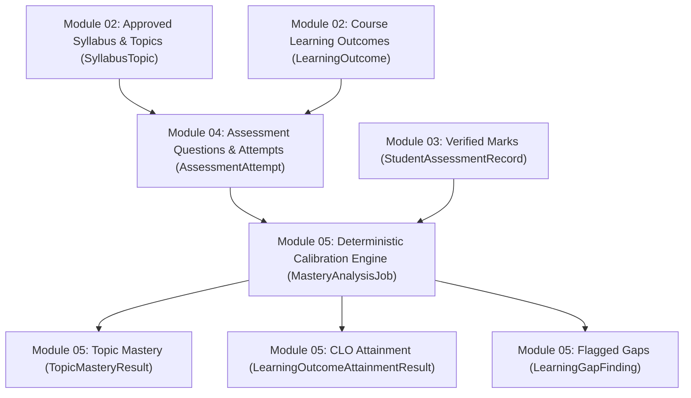
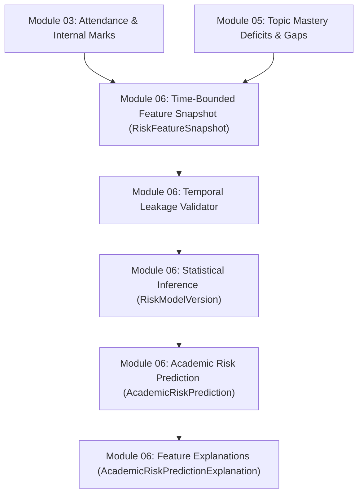
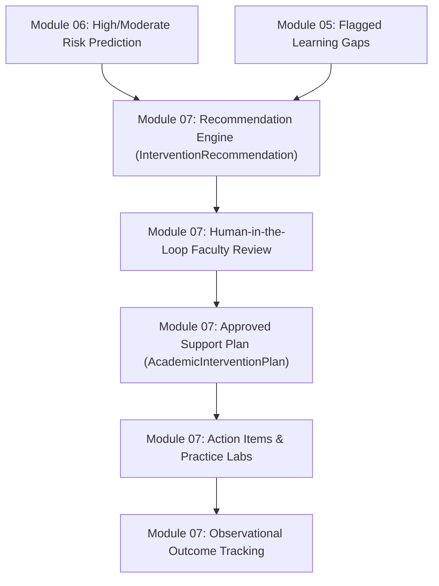
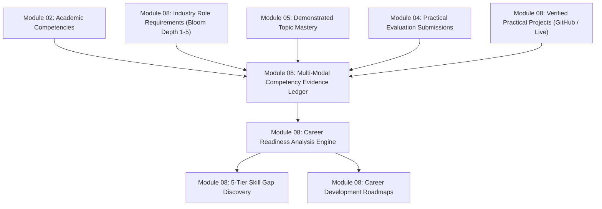
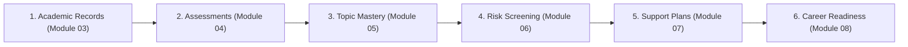

# MASTERY — Cross-Module Integration Map
## End-to-End Workflows & Inter-Module Data Provenance

**Platform:** MASTERY — Beyond Marks. Towards Mastery.  
**Team:** VARY — SRUJAN 2026  
**Problem Statement:** AI-03 — Student Performance Prediction  
**Track:** AI, CyberSecurity and Digital Trust  
**Phase:** 10/11 — Unified Intelligence Dashboard & Cross-Module Integration  

---

## 1. Cross-Module Workflow Architectures

Phase 10 connects the seven business modules through verified, explainable workflows.

### Workflow A: Curriculum to Learning Mastery

- **Data Guarantee:** Mastery calculations require that every assessment question references valid syllabus topics and CLOs approved in Module 02.
- **Traceability:** Downstream attainment records reference the exact curriculum regulation version.

---

### Workflow B: Learning Mastery to Academic Risk

- **Data Guarantee:** All feature extraction strictly precedes the prediction cutoff date.
- **Explainability:** Predictions are accompanied by specific adverse and protective factors grounded in actual student attendance and assessment history.

---

### Workflow C: Academic Risk to Personalized Intervention

- **Human-in-the-Loop:** Automated recommendations do not become active plans without explicit faculty approval and assignment.
- **Non-Causal Monitoring:** Post-intervention performance improvements are documented as observational associations, not causal proofs.

---

### Workflow D: Curriculum to Career Readiness

- **Separation of Metrics:** Core competency coverage is reported separately from practical project coverage. No single composite employability percentage is ever generated.

---

### Workflow E: Integrated Student Journey

- **Navigation & Transparency:** The unified dashboard synthesizes these six stages into clear cards with explicit module provenance, timestamped freshness, and direct navigational links.
