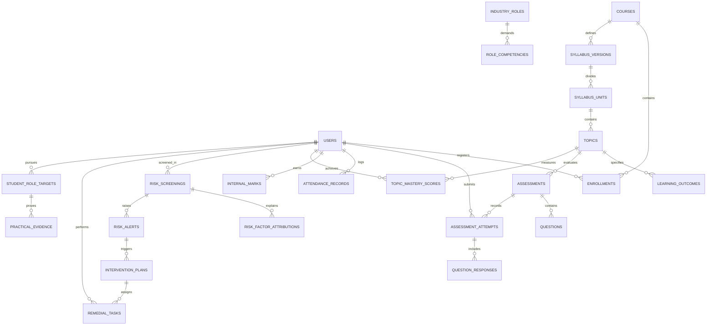

# MASTERY — Database Architecture & Entity Relationship Design

**Database Engine:** PostgreSQL 15+ (Hosted on Supabase or self-hosted)  
**ORM:** SQLAlchemy 2.0+ Declarative Mapping  
**Migration Framework:** Alembic  
**Phase:** 01/11 — Architecture & Preparation  

---

## 1. Database Design Principles

1. **UUID Primary Keys:** All primary entity identifiers use UUIDv4 (`uuid.uuid4()`) to ensure distributed generation safety and prevent integer-enumeration attacks.
2. **Standard Audit Mixin:** Every table implements `created_at` and `updated_at` timestamps stored in UTC (`DateTime(timezone=True)`).
3. **Evidence Provenance & Immutability:** Academic assessment attempts, submission telemetry, and diagnostic logs are append-only. Historical evidence is never overwritten.
4. **Decoupled Intelligence Schemas:**
   - Formal institutional records (attendance, internal marks) are stored separately from calibrated mastery records.
   - Academic risk predictions are stored with their model version and feature snapshot.
   - Industry competency evaluations are mapped to role benchmarks without polluting student academic gradebooks.
5. **Soft Deletes vs. Hard Deletes:** High-value curricular records (syllabi, question banks) employ version flags or status enums rather than hard deletes.

---

## 2. Entity Domain Matrix

| Domain | Primary Entities | Key Foreign Keys | Purpose |
| :--- | :--- | :--- | :--- |
| **Identity & Access** | `users`, `profiles`, `roles` | `user_id -> auth.users` | Multi-role authentication & profile attribution |
| **Curriculum & Syllabus** | `courses`, `syllabus_versions`, `syllabus_units`, `topics`, `learning_outcomes` | `syllabus_version_id -> courses.id`, `unit_id -> syllabus_versions.id` | Hierarchical course curriculum & Bloom taxonomy outcomes |
| **Academic Records** | `enrollments`, `attendance_records`, `internal_marks`, `assignment_scores` | `student_id -> users.id`, `course_id -> courses.id` | Institutional marks & compliance ledgers |
| **Assessments** | `assessments`, `questions`, `assessment_attempts`, `question_responses` | `assessment_id -> topics.id`, `attempt_id -> assessments.id` | Multi-modal test delivery, question bank & student responses |
| **Mastery Intelligence** | `mastery_snapshots`, `topic_mastery_scores`, `evidence_provenance_logs` | `student_id -> users.id`, `topic_id -> topics.id` | Calibrated topic-level mastery & evidence confidence |
| **Academic Risk** | `risk_screenings`, `risk_factor_attributions`, `risk_alerts`, `faculty_reviews` | `student_id -> users.id`, `screening_id -> risk_screenings.id` | Statistical risk probabilities, explainability vectors & approvals |
| **Interventions** | `intervention_plans`, `remedial_tasks`, `task_submissions`, `post_assessments` | `risk_alert_id -> risk_alerts.id`, `mentor_id -> users.id` | Actionable recovery roadmaps & longitudinal progress tracking |
| **Career Readiness** | `industry_roles`, `role_competencies`, `student_role_targets`, `practical_evidence` | `role_id -> industry_roles.id`, `student_id -> users.id` | Practical skill verification, GitHub evidence & placement radars |

---

## 3. Detailed Entity Relationship Diagram (Mermaid)



---

## 4. Key Table Schemas (DDL Reference for Future Migrations)

### `topics` (Curriculum Unit Breakdown)
```sql
CREATE TABLE topics (
    id UUID PRIMARY KEY DEFAULT gen_random_uuid(),
    unit_id UUID NOT NULL REFERENCES syllabus_units(id) ON DELETE CASCADE,
    code VARCHAR(50) NOT NULL,
    title VARCHAR(255) NOT NULL,
    description TEXT,
    order_index INTEGER NOT NULL DEFAULT 0,
    parent_topic_id UUID REFERENCES topics(id),
    created_at TIMESTAMPTZ NOT NULL DEFAULT NOW(),
    updated_at TIMESTAMPTZ NOT NULL DEFAULT NOW()
);
```

### `topic_mastery_scores` (Calibrated Demonstrated Understanding)
```sql
CREATE TABLE topic_mastery_scores (
    id UUID PRIMARY KEY DEFAULT gen_random_uuid(),
    student_id UUID NOT NULL REFERENCES users(id) ON DELETE CASCADE,
    topic_id UUID NOT NULL REFERENCES topics(id) ON DELETE CASCADE,
    mastery_percentage NUMERIC(5, 2) NOT NULL CHECK (mastery_percentage >= 0 AND mastery_percentage <= 100),
    confidence_score NUMERIC(3, 2) NOT NULL CHECK (confidence_score >= 0 AND confidence_score <= 1),
    evidence_count INTEGER NOT NULL DEFAULT 1,
    last_evaluated_at TIMESTAMPTZ NOT NULL DEFAULT NOW(),
    created_at TIMESTAMPTZ NOT NULL DEFAULT NOW(),
    updated_at TIMESTAMPTZ NOT NULL DEFAULT NOW(),
    UNIQUE(student_id, topic_id)
);
```

### `risk_screenings` (Explainable Academic Risk Screening)
```sql
CREATE TABLE risk_screenings (
    id UUID PRIMARY KEY DEFAULT gen_random_uuid(),
    student_id UUID NOT NULL REFERENCES users(id) ON DELETE CASCADE,
    course_id UUID NOT NULL REFERENCES courses(id) ON DELETE CASCADE,
    risk_level VARCHAR(20) NOT NULL CHECK (risk_level IN ('LOW', 'MODERATE', 'CRITICAL')),
    risk_probability NUMERIC(4, 3) NOT NULL CHECK (risk_probability >= 0 AND risk_probability <= 1),
    model_version VARCHAR(50) NOT NULL,
    is_reviewed_by_faculty BOOLEAN NOT NULL DEFAULT FALSE,
    screened_at TIMESTAMPTZ NOT NULL DEFAULT NOW(),
    created_at TIMESTAMPTZ NOT NULL DEFAULT NOW()
);
```

### `student_role_targets` & `practical_evidence` (Career Readiness)
```sql
CREATE TABLE practical_evidence (
    id UUID PRIMARY KEY DEFAULT gen_random_uuid(),
    student_id UUID NOT NULL REFERENCES users(id) ON DELETE CASCADE,
    competency_id UUID NOT NULL REFERENCES role_competencies(id) ON DELETE CASCADE,
    evidence_type VARCHAR(50) NOT NULL CHECK (evidence_type IN ('GITHUB_REPO', 'CODING_TEST', 'SQL_CHALLENGE', 'PROJECT_DEMO')),
    evidence_url TEXT,
    verification_status VARCHAR(20) NOT NULL DEFAULT 'PENDING' CHECK (verification_status IN ('PENDING', 'VERIFIED', 'REJECTED')),
    score NUMERIC(5, 2),
    evaluated_at TIMESTAMPTZ,
    created_at TIMESTAMPTZ NOT NULL DEFAULT NOW()
);
```

---

## 5. Row-Level Security (RLS) Strategy

For production deployment on Supabase PostgreSQL:
- **Students** can execute `SELECT` on their own records using `auth.uid() = student_id`.
- **Faculty** can `SELECT` and `INSERT/UPDATE` within courses where they are listed as instructors (`course_instructors`).
- **Admins & Service Roles** bypass RLS via Supabase service role keys for automated data synchronizations.
