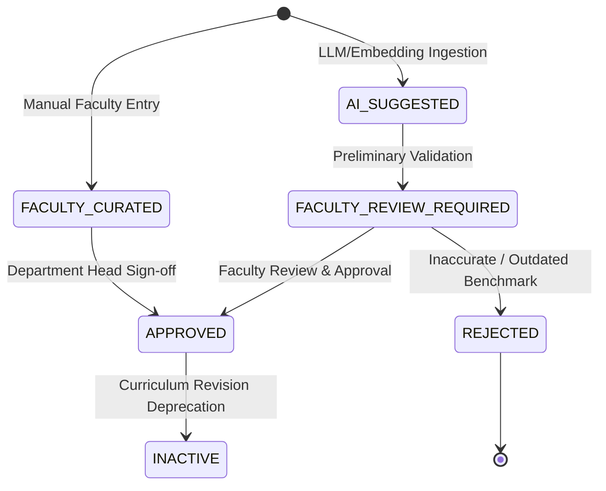

# MASTERY — Industry Competency Mapping & Provenance
## Academic-to-Industry Mapping Standards and Human Review Workflows

**Platform:** MASTERY — Beyond Marks. Towards Mastery.  
**Module:** Module 08 — Career Readiness & Industry Skill Gap Intelligence  

---

## 1. Mapping Philosophy

A core vulnerability in EdTech platforms is equating a syllabus topic with demonstrated student competency. MASTERY establishes three strict governance rules:

1. **Curriculum Coverage $\neq$ Student Mastery:**
   The fact that a university syllabus contains "RESTful APIs" proves only that the subject was taught. It does not prove that an individual student has acquired that competency.
2. **Deterministic Provenance:**
   Every requirement mapped to a role must state its origin: whether it was suggested by AI, curated by department faculty, or grounded in standard accreditation bodies (ABET, ACM, IEEE).
3. **Faculty Approval Enforcement:**
   AI may propose competency mappings, but only mappings marked `APPROVED` by authorized faculty or institution administrators are factored into authoritative career readiness calculations.

---

## 2. Mapping States & Review Lifecycle

### State Definitions:
- `AI_SUGGESTED`: Generated via automated syllabus text extraction or role definition embedding. Not eligible for student readiness scoring.
- `FACULTY_REVIEW_REQUIRED`: Queued for faculty assessment to verify accuracy and benchmark relevancy.
- `APPROVED`: Authoritative mapping. Factorable into student core and practical coverage computations.
- `REJECTED`: Declared non-essential or obsolete by faculty. Excluded from readiness evaluations.
- `INACTIVE`: Retired due to new curriculum regulations (e.g. R20 $\rightarrow$ R22).

---

## 3. Importance Tiers

Rather than assigning arbitrary numerical weights that obscure skill deficits, MASTERY uses four distinct importance tiers:

1. **`CORE` (or `HIGH`):** Non-negotiable foundational competency for the occupation. Deficits in core competencies trigger High Priority skill gaps and directly cap the overall evidence alignment category.
2. **`IMPORTANT` (or `MEDIUM`):** Substantial competency expected for effective execution.
3. **`SUPPORTING`:** Enhances candidate capability and velocity (e.g., specific build tools or secondary frameworks).
4. **`OPTIONAL`:** Niche or specialized domain extensions.

---

## 4. Mapping Integrity Guardrails

- **Zero Fabricated Market Data:** MASTERY does not scrape live job sites or fabricate salary / demand percentages without authorized data integrations.
- **Traceable Depth Levels:** Required depth is strictly calibrated on a 1–5 scale reflecting Bloom's Taxonomy:
  * Level 1: Remember / Recall
  * Level 2: Understand / Explain
  * Level 3: Apply / Execute
  * Level 4: Analyze / Optimize
  * Level 5: Evaluate / Design Architecture
