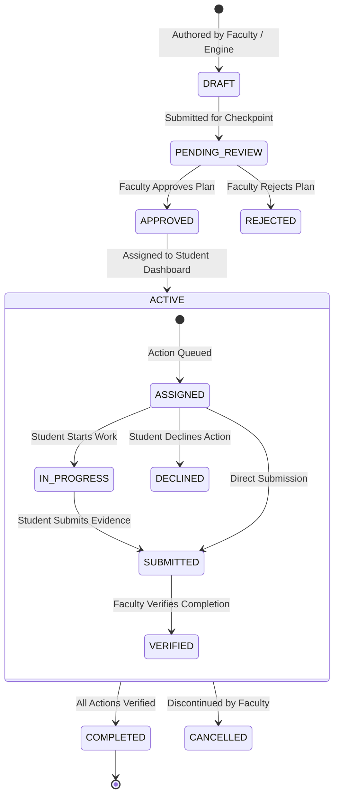

# Module 07: Academic Intervention Plan & Action Lifecycle

**Platform:** MASTERY — Beyond Marks. Towards Mastery.  
**Team:** VARY — SRUJAN 2026  
**Problem Statement:** AI-03 — Student Performance Prediction  
**Track:** AI, CyberSecurity and Digital Trust  
**Phase:** 08/11  
**Module:** 07 — Personalized Academic Intervention Engine  

---

## 1. Dual-Hierarchy Lifecycle Overview

MASTERY implements a dual-hierarchy state machine:
1. **Plan-Level Lifecycle:** Governs pedagogical governance, faculty authorization, and holistic plan completion (`academic_intervention_plans.plan_status`).
2. **Action-Level Lifecycle:** Governs student task execution, evidence submission, and faculty verification (`academic_intervention_actions.action_status`).

---

## 2. Plan State Transitions & Validation Rules

| Current Status | Target Status | Permitted Actor | Prerequisite & Validation Rule |
| :--- | :--- | :--- | :--- |
| `DRAFT` | `PENDING_REVIEW` | `FACULTY`, `ADMIN` | Initial plan creation with at least 1 action item. |
| `PENDING_REVIEW` | `APPROVED` | `FACULTY`, `ADMIN` | Explicit faculty approval checkpoint with optional review notes. |
| `PENDING_REVIEW` | `REJECTED` | `FACULTY`, `ADMIN` | Faculty rejects plan with mandatory justification notes. |
| `APPROVED` | `ACTIVE` | `FACULTY`, `ADMIN` | Assigned to student. All child actions transition from `PROPOSED` to `ASSIGNED`. |
| `ACTIVE` | `COMPLETED` | System / Faculty | Automatically triggered when 100% of child actions reach `VERIFIED` or `DECLINED`. |
| Any Active | `CANCELLED` | `FACULTY`, `ADMIN` | Faculty discontinues plan with audit explanation. |

---

## 3. Action State Transitions & Student Workflow

| Current Status | Target Status | Permitted Actor | Action & Artifacts Required |
| :--- | :--- | :--- | :--- |
| `PROPOSED` | `ASSIGNED` | System | Auto-promoted when parent plan transitions to `ACTIVE`. |
| `ASSIGNED` | `IN_PROGRESS` | `STUDENT` | Student acknowledges task and begins independent work. |
| `IN_PROGRESS` | `SUBMITTED` | `STUDENT` | Student submits completion notes and optional solution repository link (`student_submission_url`). |
| `SUBMITTED` | `VERIFIED` | `FACULTY` | Course faculty reviews submitted evidence and records verification remarks (`faculty_feedback`). |
| `ASSIGNED` | `DECLINED` | `STUDENT` | Student formally declines optional task with stated justification. |

---

## 4. Immutable Progress Audit Ledger (`intervention_progress_events`)

Every state transition produces an append-only audit event capturing:
- `actor_profile_id`: Authenticated user executing the change.
- `event_type`: Standard event code (`PLAN_CREATED`, `PLAN_APPROVED`, `ACTION_SUBMITTED`, `ACTION_VERIFIED`, etc.).
- `previous_status` and `new_status`.
- `event_notes`: Human-readable explanation.
- `created_at`: Server-side UTC timestamp.
