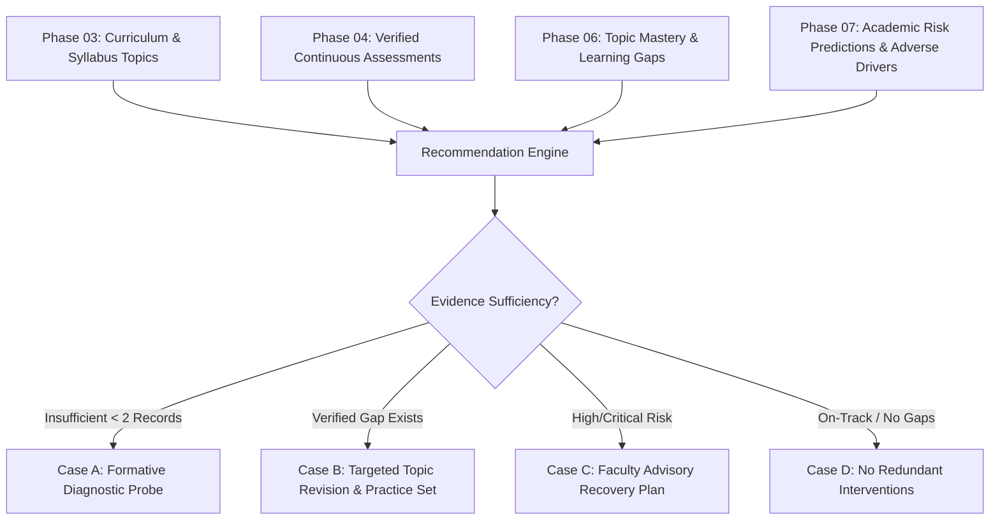

# Module 07: Intervention Recommendation Engine & Algorithmic Rules

**Platform:** MASTERY — Beyond Marks. Towards Mastery.  
**Team:** VARY — SRUJAN 2026  
**Problem Statement:** AI-03 — Student Performance Prediction  
**Track:** AI, CyberSecurity and Digital Trust  
**Phase:** 08/11  
**Module:** 07 — Personalized Academic Intervention Engine  

---

## 1. Engine Philosophy & Educational Grounding

The **Intervention Recommendation Engine** (`InterventionRecommendationService`) is designed around a single non-negotiable principle:
> **Recommendations must be grounded strictly in empirical, verified academic evidence, not arbitrary thresholds, demographic heuristics, or unverified behavioral telemetry.**

In conventional systems, low-scoring students are often subjected to generic, punitive advice ("Study harder", "Attend classes"). In contrast, MASTERY operates as a diagnostic, prescriptive engine:
- Pinpoints the exact syllabus topic or course learning outcome where conceptual breakdown occurred.
- Explains the evidentiary reason why the recommendation is generated.
- Proposes a concrete, measurable action with estimated student effort.
- Distinguishes genuine mastery gaps from missing/insufficient data.

---

## 2. Evidence Ingestion Hierarchy

The recommendation engine synthesizes evidence across four preceding platform tiers:

---

## 3. Mandatory Recommendation Logic & Case Rules

### Case A: Insufficient Evidence Handling
- **Trigger:** Upstream Phase 06 topic mastery or Phase 07 risk prediction evaluates to `INSUFFICIENT_EVIDENCE` ($< 2$ continuous assessments).
- **Rule:** The engine is **strictly barred** from generating a remedial intervention, low-ability classification, or failure assumption.
- **Action Generated:** Recommends a low-stakes formative diagnostic assessment (`FORMATIVE_ASSESSMENT` / `EVIDENCE_COLLECTION`).
- **Standard Explanation:**
  > "Assessment evidence is currently insufficient to reliably assess topic mastery or academic risk. A low-stakes formative evaluation is recommended to establish an empirical learning baseline."
- **Priority:** `LOW`.

### Case B: Persistent Verified Low Performance
- **Trigger:** Phase 06 identifies an open `LearningGapFinding` with `finding_type == 'PERSISTENT_LOW_SCORE'` or `TopicMasteryResult.mastery_status == 'NEEDS_ATTENTION'`.
- **Rule:** Recommends targeted topic revision (`TARGETED_REVISION`) or adaptive problem practice (`PRACTICE_SET`) mapped to the specific topic and Bloom's cognitive level.
- **Priority Mapping:**
  - Gap severity `CRITICAL` $\rightarrow$ Priority `CRITICAL`
  - Gap severity `HIGH` $\rightarrow$ Priority `HIGH`
  - Gap severity `MEDIUM` $\rightarrow$ Priority `MEDIUM`
- **Action Generated:** Core reading review notes, worked example analysis, and 3 formative problem tasks.

### Case C: High or Critical Academic Risk
- **Trigger:** Phase 07 outputs an active `AcademicRiskPrediction` with `risk_classification == 'HIGH'`.
- **Rule:** Recommends an individual faculty advisory consultation (`FACULTY_CONSULTATION`).
- **Priority:** `HIGH`.
- **Action Generated:** 1-on-1 office hours meeting to review continuous assessment feedback and co-design an individual recovery roadmap.
- **Review Constraint:** Mandatory faculty review prior to student dispatch.

### Case D: Protective Factors & Improving Performance
- **Trigger:** Upstream feature vector shows positive trajectory or high continuous assessment average ($> 70\%$).
- **Rule:** The engine highlights protective strengths in the rationale rather than producing an unnecessarily deficit-focused intervention.

### Case E: Duplicate Prevention & Supersession
- **Rule:** If an active recommendation already exists for the same student, subject, and topic, duplicate creation is prevented to avoid alert fatigue.

---

## 4. Deterministic Baseline vs. AI Synthesis

1. **Deterministic Core:** The recommendation rules operate completely deterministically via Python services without requiring external LLM APIs.
2. **AI Assistance (Optional):** Where configured, centralized AI services may only assist in rephrasing explanations into supportive, student-friendly prose and formatting study checklists. AI is **never** permitted to invent evidence, determine risk probabilities, or bypass faculty review checkpoints.
