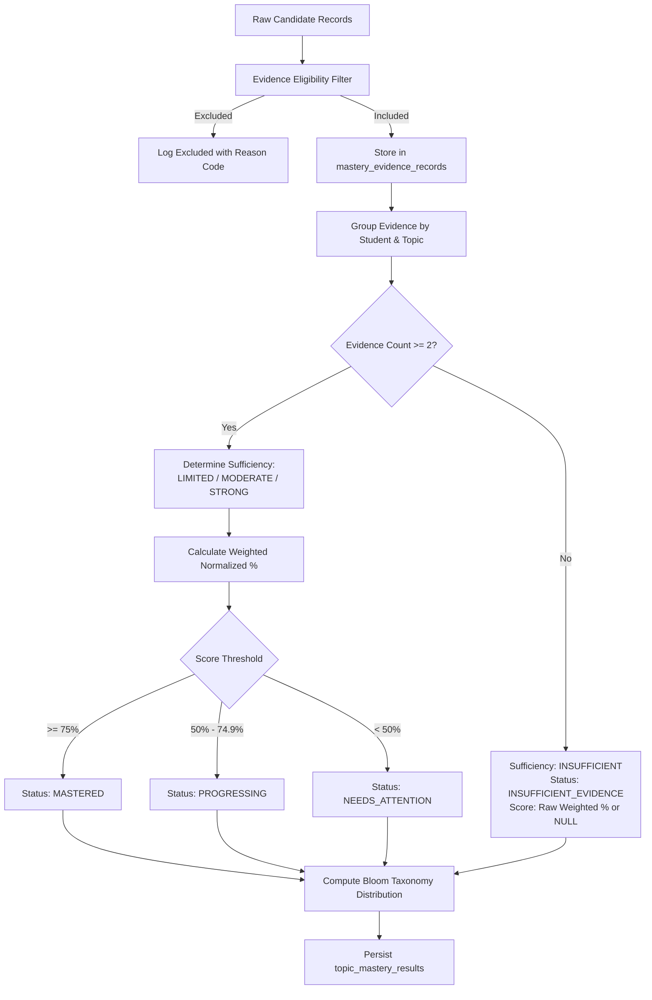
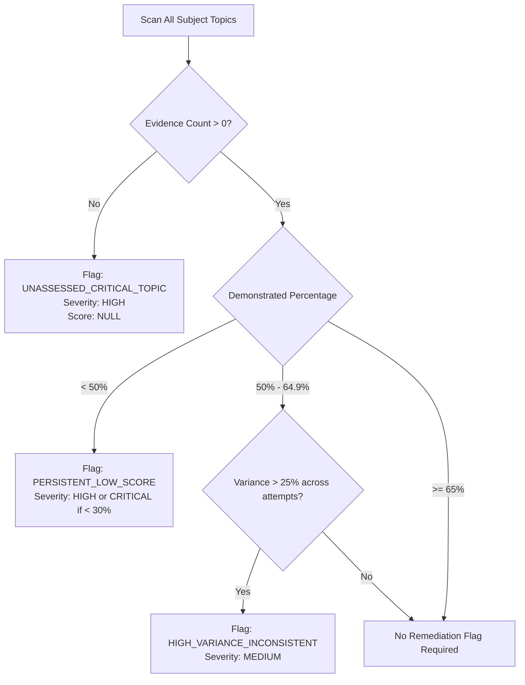

# Learning Mastery & Performance Analytics — Algorithm Specification

**Platform:** MASTERY — Beyond Marks. Towards Mastery.  
**Module:** Module 05: Learning Mastery & Performance Analytics  
**Phase:** 06/11  
**Team:** VARY — SRUJAN 2026  
**Problem Statement:** AI-03 — Student Performance Prediction  
**Track:** AI, CyberSecurity and Digital Trust  

---

## 1. Algorithmic Foundation & Philosophy

Conventional grading paradigms aggregate scores by summing points without accounting for:
1. Topic coverage distribution (e.g., student scored 100% on unit 1 questions, but 0 questions were tested on unit 4).
2. Assessment instrument variation (quizzes vs midterms vs laboratory performance).
3. Evidence sufficiency (drawing high-confidence conclusions from 1 single true/false question).
4. The statistical distortion of equating **lack of evidence** with **zero mastery**.

The **MASTERY Calculation Engine** implements an evidence-backed, mathematically grounded calculation pipeline designed to reflect genuine learning demonstration without false assumptions.

---

## 2. Topic Mastery Calculation Pipeline

### 2.1. Weighted Normalized Performance Calculation

For a student $s$ and topic $t$, given a set of $n$ eligible evidence items $E = \{e_1, e_2, \dots, e_n\}$, where each item $e_i$ has marks obtained $o_i$, marks possible $m_i$, and assessment instrument weight $w_i$:

$$\text{Demonstrated Percentage } P(s, t) = \frac{\sum_{i=1}^n w_i \cdot o_i}{\sum_{i=1}^n w_i \cdot m_i} \times 100$$

Where instrument weights $w_i$ are assigned as:
- **FINAL_EXAM:** $w = 2.0$
- **MIDTERM:** $w = 1.5$
- **QUIZ:** $w = 1.0$
- **ASSIGNMENT:** $w = 1.0$
- **PRACTICE_QUIZ (if selected):** $w = 0.5$

If $n = 0$ (no eligible evidence exists for topic $t$):
$$P(s, t) = \text{NULL}$$
The system strictly persists an explicit SQL `NULL` and prevents conversion to $0.0\%$.

---

### 2.2. Evidence Sufficiency Levels

Evidence sufficiency categorizes the statistical credibility of the sample size:

| Sufficiency Level | Evidence Count ($n$) | Distinct Assessment Instruments ($k$) |
|---|---|---|
| `INSUFFICIENT` | $n < 2$ | Any |
| `LIMITED` | $2 \le n < 4$ | Any |
| `MODERATE` | $n \ge 4$ | $k < 2$ |
| `STRONG` | $n \ge 4$ | $k \ge 2$ |

---

### 2.3. Confidence Categories

Confidence represents the reliability of the derived conclusion:
- **`LOW`:** Assigned whenever sufficiency is `INSUFFICIENT` ($n < 2$) or `LIMITED` ($2 \le n < 4$).
- **`MEDIUM`:** Assigned when sufficiency is `MODERATE` ($n \ge 4$, single assessment instrument).
- **`HIGH`:** Assigned when sufficiency is `STRONG` ($n \ge 4$, multiple distinct assessment instruments).

---

### 2.4. Mastery Status Assignment

| Mastery Status | Mathematical Condition |
|---|---|
| `INSUFFICIENT_EVIDENCE` | Sufficiency Level is `INSUFFICIENT` ($n < 2$) |
| `MASTERED` | Sufficiency Level $\ne$ `INSUFFICIENT` **AND** $P(s, t) \ge 75.0\%$ |
| `PROGRESSING` | Sufficiency Level $\ne$ `INSUFFICIENT` **AND** $50.0\% \le P(s, t) < 75.0\%$ |
| `NEEDS_ATTENTION` | Sufficiency Level $\ne$ `INSUFFICIENT` **AND** $P(s, t) < 50.0\%$ |

---

## 3. Course Learning Outcome (CLO) Attainment

For student $s$ and outcome $O$, evidence items mapped directly to $O$ (via question learning outcome mapping) are aggregated:

$$\text{Attainment Percentage } A(s, O) = \frac{\sum_{j=1}^m w_j \cdot o_j}{\sum_{j=1}^m w_j \cdot m_j} \times 100$$

Attainment Status criteria (default target threshold $T = 60.0\%$):
- **`INSUFFICIENT_EVIDENCE`:** $m = 0$ (unassessed outcome; explicitly persisted as `NULL`).
- **`ATTAINED`:** $A(s, O) \ge T$ (default $\ge 60\%$).
- **`PARTIALLY_ATTAINED`:** $40.0\% \le A(s, O) < T$.
- **`NOT_ATTAINED`:** $A(s, O) < 40.0\%$.

---

## 4. Learning Gap Discovery Algorithm

Learning gaps identify specific areas requiring academic remediation. The engine differentiates performance failures from missing curriculum evaluations:

### Gap Classification Criteria:
1. **`PERSISTENT_LOW_SCORE`:**
   - Condition: $n \ge 2$ and $P(s, t) < 50.0\%$.
   - Severity: `CRITICAL` if $P(s, t) < 30.0\%$, else `HIGH`.
2. **`UNASSESSED_CRITICAL_TOPIC`:**
   - Condition: $n = 0$ for a syllabus topic in an active course.
   - Severity: `HIGH`.
   - Score: Explicitly `NULL`.
3. **`HIGH_VARIANCE_INCONSISTENT`:**
   - Condition: $n \ge 3$, average score between $50\%$ and $65\%$, and maximum individual item score difference $\ge 35\%$.
   - Severity: `MEDIUM`.

---

## 5. Bloom's Revised Taxonomy Cognitive Breakdown

For each topic and for the overall student profile, evidence items are grouped by their cognitive taxonomy tag:
- `REMEMBER`
- `UNDERSTAND`
- `APPLY`
- `ANALYZE`
- `EVALUATE`
- `CREATE`

For cognitive level $L$:
$$P_L = \frac{\sum_{i \in L} o_i}{\sum_{i \in L} m_i} \times 100$$
If no items are tagged with level $L$, $P_L$ is recorded as `NULL`.

---

## 6. Scientific Governance Disclaimer

To maintain algorithmic integrity and prevent misuse in high-stakes decisions, every schema, API payload, and user interface component returning mastery results embeds the mandatory non-mastery disclaimer:

> *"Learning mastery metrics reflect observed, normalized performance across eligible assessment items. They represent evidence-backed indicators of topic familiarity and must NEVER be equated with a scientifically proven measure of total internal conceptual mastery or student intelligence."*
