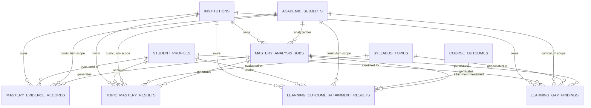

# Learning Mastery & Performance Analytics — Data Model Specification

**Platform:** MASTERY — Beyond Marks. Towards Mastery.  
**Module:** Module 05: Learning Mastery & Performance Analytics  
**Phase:** 06/11  
**Team:** VARY — SRUJAN 2026  
**Problem Statement:** AI-03 — Student Performance Prediction  
**Track:** AI, CyberSecurity and Digital Trust  

---

## 1. Architectural Overview & Design Philosophy

The **Learning Mastery & Performance Analytics Data Model** is engineered to transform raw assessment responses and official verified academic marks into explainable, traceable, and deterministic topic-level and outcome-level mastery intelligence.

### Core Tenets
1. **Deterministic Traceability:** Every mastery percentage and outcome attainment score links directly to immutable foreign keys in `mastery_evidence_records`.
2. **Explicit Null Preservation:** Unassessed syllabus topics and unassessed Course Learning Outcomes (CLOs) are explicitly stored as `NULL` performance values rather than defaulting to `0%`.
3. **Anti-Double-Counting Guard:** Strict unique constraints and precedence rules prevent dual counting of question-level assessment responses alongside aggregated gradebook entries.
4. **Tenant Isolation & Row-Level Security (RLS):** All 5 tables enforce multi-tenant isolation via `institution_id` with active PostgreSQL RLS policies for `STUDENT`, `FACULTY`, `INSTITUTION_ADMIN`, and `SUPER_ADMIN`.

---

## 2. Entity Relationship Diagram

---

## 3. Database Table Schemas

### 3.1. `mastery_analysis_jobs`
Tracks batches of mastery calculations, execution parameters, performance runtimes, and tenant context.

| Column | Type | Nullable | Default | Description |
|---|---|---|---|---|
| `id` | `VARCHAR(36)` | No | `uuid4()` | Primary Key |
| `institution_id` | `VARCHAR(36)` | No | - | Foreign Key -> `institutions.id` (ON DELETE CASCADE) |
| `subject_id` | `VARCHAR(36)` | No | - | Foreign Key -> `academic_subjects.id` (ON DELETE CASCADE) |
| `triggered_by_profile_id` | `VARCHAR(36)` | Yes | `NULL` | Foreign Key -> `user_profiles.id` (ON DELETE SET NULL) |
| `job_type` | `VARCHAR(50)` | No | `'FULL_SUBJECT_RECALCULATION'` | Recalculation type (`FULL_SUBJECT_RECALCULATION`, `SINGLE_STUDENT_UPDATE`) |
| `target_student_id` | `VARCHAR(36)` | Yes | `NULL` | Foreign Key -> `student_academic_profiles.id` (ON DELETE CASCADE) |
| `status` | `VARCHAR(30)` | No | `'PENDING'` | `PENDING`, `RUNNING`, `COMPLETED`, `FAILED` |
| `parameters_json` | `JSONB` | No | `'{}'` | Run configuration: min evidence threshold, include practice flag, weights |
| `records_processed` | `INTEGER` | No | `0` | Number of candidate records processed |
| `evidence_included_count` | `INTEGER` | No | `0` | Number of included evidence items |
| `evidence_excluded_count` | `INTEGER` | No | `0` | Number of excluded evidence items |
| `error_details` | `TEXT` | Yes | `NULL` | Execution error stack or failure reason |
| `started_at` | `TIMESTAMP WITH TIME ZONE` | Yes | `NULL` | Job execution start timestamp |
| `completed_at` | `TIMESTAMP WITH TIME ZONE` | Yes | `NULL` | Job execution completion timestamp |
| `created_at` | `TIMESTAMP WITH TIME ZONE` | No | `now()` | Record creation timestamp |
| `updated_at` | `TIMESTAMP WITH TIME ZONE` | No | `now()` | Record update timestamp |

**Indexes:**
- `ix_mastery_jobs_institution` ON `(institution_id)`
- `ix_mastery_jobs_subject` ON `(subject_id)`
- `ix_mastery_jobs_status` ON `(status)`

---

### 3.2. `mastery_evidence_records`
Stores immutable normalized granular evidence derived from student assessment responses or official gradebook entries, documenting eligibility or exclusion rationale.

| Column | Type | Nullable | Default | Description |
|---|---|---|---|---|
| `id` | `VARCHAR(36)` | No | `uuid4()` | Primary Key |
| `institution_id` | `VARCHAR(36)` | No | - | Foreign Key -> `institutions.id` (ON DELETE CASCADE) |
| `job_id` | `VARCHAR(36)` | Yes | `NULL` | Foreign Key -> `mastery_analysis_jobs.id` (ON DELETE SET NULL) |
| `student_id` | `VARCHAR(36)` | No | - | Foreign Key -> `student_academic_profiles.id` (ON DELETE CASCADE) |
| `subject_id` | `VARCHAR(36)` | No | - | Foreign Key -> `academic_subjects.id` (ON DELETE CASCADE) |
| `topic_id` | `VARCHAR(36)` | Yes | `NULL` | Foreign Key -> `syllabus_topics.id` (ON DELETE SET NULL) |
| `outcome_id` | `VARCHAR(36)` | Yes | `NULL` | Foreign Key -> `course_learning_outcomes.id` (ON DELETE SET NULL) |
| `source_type` | `VARCHAR(50)` | No | - | `'ASSESSMENT_QUESTION'`, `'ASSESSMENT_TOTAL'`, `'OFFICIAL_GRADEBOOK'` |
| `source_attempt_id` | `VARCHAR(36)` | Yes | `NULL` | Foreign Key -> `student_assessment_attempts.id` (ON DELETE SET NULL) |
| `source_response_id` | `VARCHAR(36)` | Yes | `NULL` | Foreign Key -> `student_assessment_responses.id` (ON DELETE SET NULL) |
| `source_performance_id`| `VARCHAR(36)` | Yes | `NULL` | Foreign Key -> `student_assessment_performances.id` (ON DELETE SET NULL) |
| `marks_obtained` | `NUMERIC(6, 2)`| No | - | Raw marks awarded |
| `marks_possible` | `NUMERIC(6, 2)`| No | - | Maximum possible marks for this item |
| `normalized_percentage`| `NUMERIC(5, 2)`| No | - | `(marks_obtained / marks_possible) * 100` |
| `weight` | `NUMERIC(4, 2)`| No | `1.0` | Weighting factor (assessment type multiplier) |
| `assessment_type` | `VARCHAR(50)` | No | - | `QUIZ`, `MIDTERM`, `FINAL_EXAM`, `PRACTICE_QUIZ`, `ASSIGNMENT` |
| `bloom_level` | `VARCHAR(50)` | Yes | `NULL` | Bloom's Revised Taxonomy level |
| `attempt_timestamp` | `TIMESTAMP WITH TIME ZONE` | No | - | Real-world timestamp when student performed the item |
| `eligibility_status` | `VARCHAR(30)` | No | `'INCLUDED'` | `'INCLUDED'`, `'EXCLUDED'` |
| `exclusion_reason` | `VARCHAR(50)` | Yes | `NULL` | Enum: `PRACTICE_MODE_UNSELECTED`, `DUPLICATE_SUPERSEDED`, `UNVERIFIED_DATA`, etc. |
| `created_at` | `TIMESTAMP WITH TIME ZONE` | No | `now()` | Record creation timestamp |
| `updated_at` | `TIMESTAMP WITH TIME ZONE` | No | `now()` | Record update timestamp |

**Constraints & Indexes:**
- Unique Constraint: `uq_mastery_evidence_source` ON `(student_id, source_type, source_response_id, source_performance_id)`
- `ix_mastery_evidence_student_subject` ON `(student_id, subject_id)`
- `ix_mastery_evidence_topic` ON `(topic_id)`
- `ix_mastery_evidence_outcome` ON `(outcome_id)`
- `ix_mastery_evidence_eligibility` ON `(eligibility_status)`

---

### 3.3. `topic_mastery_results`
Represents the computed mastery status, normalized score, confidence, and Bloom's distribution for a student on a specific syllabus topic.

| Column | Type | Nullable | Default | Description |
|---|---|---|---|---|
| `id` | `VARCHAR(36)` | No | `uuid4()` | Primary Key |
| `institution_id` | `VARCHAR(36)` | No | - | Foreign Key -> `institutions.id` (ON DELETE CASCADE) |
| `job_id` | `VARCHAR(36)` | Yes | `NULL` | Foreign Key -> `mastery_analysis_jobs.id` (ON DELETE SET NULL) |
| `student_id` | `VARCHAR(36)` | No | - | Foreign Key -> `student_academic_profiles.id` (ON DELETE CASCADE) |
| `subject_id` | `VARCHAR(36)` | No | - | Foreign Key -> `academic_subjects.id` (ON DELETE CASCADE) |
| `topic_id` | `VARCHAR(36)` | No | - | Foreign Key -> `syllabus_topics.id` (ON DELETE CASCADE) |
| `demonstrated_percentage`| `NUMERIC(5, 2)`| Yes | `NULL` | Weighted percentage (`NULL` if unassessed) |
| `raw_points_earned` | `NUMERIC(8, 2)`| No | `0.0` | Sum of weighted marks obtained |
| `raw_points_possible` | `NUMERIC(8, 2)`| No | `0.0` | Sum of weighted marks possible |
| `evidence_count` | `INTEGER` | No | `0` | Count of eligible contributing evidence records |
| `distinct_assessment_types_count` | `INTEGER` | No | `0` | Count of distinct assessment instruments |
| `sufficiency_level` | `VARCHAR(30)` | No | `'INSUFFICIENT'` | `INSUFFICIENT`, `LIMITED`, `MODERATE`, `STRONG` |
| `confidence_category` | `VARCHAR(30)` | No | `'LOW'` | `LOW`, `MEDIUM`, `HIGH` |
| `mastery_status` | `VARCHAR(30)` | No | `'INSUFFICIENT_EVIDENCE'` | `MASTERED`, `PROGRESSING`, `NEEDS_ATTENTION`, `INSUFFICIENT_EVIDENCE` |
| `first_evaluated_at` | `TIMESTAMP WITH TIME ZONE` | Yes | `NULL` | Earliest evidence timestamp |
| `last_evaluated_at` | `TIMESTAMP WITH TIME ZONE` | Yes | `NULL` | Latest evidence timestamp |
| `bloom_level_distribution_json` | `JSONB` | No | `'{}'` | Normalized score per Bloom's level |
| `scientific_disclaimer` | `TEXT` | No | `...` | Mandatory scientific disclaimer string |
| `created_at` | `TIMESTAMP WITH TIME ZONE` | No | `now()` | Record creation timestamp |
| `updated_at` | `TIMESTAMP WITH TIME ZONE` | No | `now()` | Record update timestamp |

**Constraints & Indexes:**
- Unique Constraint: `uq_student_subject_topic_mastery` ON `(student_id, subject_id, topic_id)`
- `ix_topic_mastery_student` ON `(student_id)`
- `ix_topic_mastery_status` ON `(mastery_status)`
- `ix_topic_mastery_topic` ON `(topic_id)`

---

### 3.4. `learning_outcome_attainment_results`
Captures Course Learning Outcome (CLO) attainment aggregated across mapped assessment items.

| Column | Type | Nullable | Default | Description |
|---|---|---|---|---|
| `id` | `VARCHAR(36)` | No | `uuid4()` | Primary Key |
| `institution_id` | `VARCHAR(36)` | No | - | Foreign Key -> `institutions.id` (ON DELETE CASCADE) |
| `job_id` | `VARCHAR(36)` | Yes | `NULL` | Foreign Key -> `mastery_analysis_jobs.id` (ON DELETE SET NULL) |
| `student_id` | `VARCHAR(36)` | No | - | Foreign Key -> `student_academic_profiles.id` (ON DELETE CASCADE) |
| `subject_id` | `VARCHAR(36)` | No | - | Foreign Key -> `academic_subjects.id` (ON DELETE CASCADE) |
| `outcome_id` | `VARCHAR(36)` | No | - | Foreign Key -> `course_learning_outcomes.id` (ON DELETE CASCADE) |
| `attainment_percentage` | `NUMERIC(5, 2)`| Yes | `NULL` | Attainment percentage (`NULL` if unassessed) |
| `evidence_count` | `INTEGER` | No | `0` | Number of mapped evidence items |
| `attainment_status` | `VARCHAR(30)` | No | `'INSUFFICIENT_EVIDENCE'` | `ATTAINED`, `PARTIALLY_ATTAINED`, `NOT_ATTAINED`, `INSUFFICIENT_EVIDENCE` |
| `threshold_percentage` | `NUMERIC(5, 2)`| No | `60.0` | Institutional attainment target |
| `scientific_disclaimer` | `TEXT` | No | `...` | Mandatory scientific disclaimer string |
| `created_at` | `TIMESTAMP WITH TIME ZONE` | No | `now()` | Record creation timestamp |
| `updated_at` | `TIMESTAMP WITH TIME ZONE` | No | `now()` | Record update timestamp |

**Constraints & Indexes:**
- Unique Constraint: `uq_student_outcome_attainment` ON `(student_id, outcome_id)`
- `ix_outcome_attainment_student` ON `(student_id)`
- `ix_outcome_attainment_outcome` ON `(outcome_id)`
- `ix_outcome_attainment_status` ON `(attainment_status)`

---

### 3.5. `learning_gap_findings`
Identifies and categorizes curriculum learning vulnerabilities, rigorously distinguishing performance deficits from missing evidence gaps.

| Column | Type | Nullable | Default | Description |
|---|---|---|---|---|
| `id` | `VARCHAR(36)` | No | `uuid4()` | Primary Key |
| `institution_id` | `VARCHAR(36)` | No | - | Foreign Key -> `institutions.id` (ON DELETE CASCADE) |
| `job_id` | `VARCHAR(36)` | Yes | `NULL` | Foreign Key -> `mastery_analysis_jobs.id` (ON DELETE SET NULL) |
| `student_id` | `VARCHAR(36)` | No | - | Foreign Key -> `student_academic_profiles.id` (ON DELETE CASCADE) |
| `subject_id` | `VARCHAR(36)` | No | - | Foreign Key -> `academic_subjects.id` (ON DELETE CASCADE) |
| `topic_id` | `VARCHAR(36)` | Yes | `NULL` | Foreign Key -> `syllabus_topics.id` (ON DELETE SET NULL) |
| `outcome_id` | `VARCHAR(36)` | Yes | `NULL` | Foreign Key -> `course_learning_outcomes.id` (ON DELETE SET NULL) |
| `gap_type` | `VARCHAR(50)` | No | - | `PERSISTENT_LOW_SCORE`, `PREREQUISITE_DEFICIT`, `UNASSESSED_CRITICAL_TOPIC`, `HIGH_VARIANCE_INCONSISTENT` |
| `severity` | `VARCHAR(30)` | No | `'MEDIUM'` | `LOW`, `MEDIUM`, `HIGH`, `CRITICAL` |
| `observed_percentage` | `NUMERIC(5, 2)`| Yes | `NULL` | Demonstrated score (`NULL` if unassessed gap) |
| `description` | `TEXT` | No | - | Human-readable explanation of the finding |
| `supporting_evidence_json`| `JSONB` | No | `'{}'` | Metadata: items assessed, points missed, failure patterns |
| `is_resolved` | `BOOLEAN` | No | `False` | True if verified remediated in future analyses |
| `created_at` | `TIMESTAMP WITH TIME ZONE` | No | `now()` | Record creation timestamp |
| `updated_at` | `TIMESTAMP WITH TIME ZONE` | No | `now()` | Record update timestamp |

**Indexes:**
- `ix_learning_gaps_student_subject` ON `(student_id, subject_id)`
- `ix_learning_gaps_severity` ON `(severity)`
- `ix_learning_gaps_type` ON `(gap_type)`

---

## 4. Multi-Tenant Row-Level Security (RLS)

All 5 Module 05 tables have PostgreSQL RLS enabled and enforced (`ALTER TABLE ... ENABLE ROW LEVEL SECURITY; ALTER TABLE ... FORCE ROW LEVEL SECURITY;`).

Policies defined in `backend/migrations/005_learning_mastery_rls.sql`:
1. **SUPER_ADMIN Policy:** Unrestricted read and write access across all institutions.
2. **INSTITUTION_ADMIN & FACULTY Policy:** Full select, insert, update, delete within their verified `institution_id`.
3. **STUDENT Policy:** Read-only access restricted strictly to rows where `student_id` maps to the student profile associated with `auth.uid()`. Write operations are forbidden.
