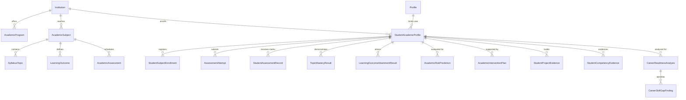

# MASTERY — Phase 10/11 Pre-Implementation Audit
## Unified Intelligence Dashboard & Cross-Module Integration

**Platform:** MASTERY — Beyond Marks. Towards Mastery.  
**Team:** VARY — SRUJAN 2026  
**Problem Statement:** AI-03 — Student Performance Prediction  
**Track:** AI, CyberSecurity and Digital Trust  
**Current Phase:** Phase 10/11  
**Previous Phase:** Phase 09/11 — Career Readiness & Industry Skill Gap Intelligence  
**Verified Commit on `main`:** `546ff0d`  
**Mandatory Working Branch:** `main`  
**Next Phase:** Phase 11/11 — Testing, Security, Optimization & Final Hackathon Prototype (DO NOT START)

---

## 1. Executive Summary & Git Verification

A comprehensive pre-implementation audit was conducted directly on the `main` branch to inspect the codebase, database schema, service architecture, and API layer across all previously delivered phases.

### 1.1 Git Status & Synchronization Verification
- **Current Branch:** `main`
- **Remote:** `origin` (`https://github.com/RutuRaj-1/SRUJAN_VARY_AI-03_Student_Performance_Prediction.git`)
- **Remote Synchronization:** In sync with `origin/main` (`546ff0d`).
- **Phase 09 Commit:** `546ff0d` (`feat(career-readiness): implement Phase 09 Module 08 Career Readiness & Industry Skill Gap Intelligence`) verified as HEAD of `main`.
- **Preceding Phase 08 Commit:** `a293e5b` (`feat(interventions): implement Phase 08 Module 07 Personalized Academic Intervention Engine`) verified in linear history.
- **Branch Rule:** All development for Phase 10 will occur strictly on `main`. No feature branches or pull requests will be created.

---

## 2. Seven Business Modules Integration Inventory

| Module # & Name | Backend Router Prefix | Primary DB Models | Service Layer | Frontend Route & Workspace | Authorization Rules | Test Coverage |
|---|---|---|---|---|---|---|
| **Module 02: AI Syllabus & Competency Intelligence** | `/api/v1/syllabus` | `AcademicProgram`, `AcademicSubject`, `SyllabusDocument`, `SyllabusUnit`, `SyllabusTopic`, `LearningOutcome`, `Competency`, `SubjectCompetencyMapping`, `IndustryRoleProfile`, `IndustryCompetencyRequirement`, `CurriculumGapAnalysis`, `SyllabusReviewHistory` | `ai_structuring_service`, `competency_service`, `document_service`, `gap_analysis_service`, `industry_mapping_service`, `review_service` | `/syllabus`  `frontend/src/features/syllabus` | Super Admin, Institution Admin, Faculty (manage); Student (read) | `test_syllabus.py` (6 tests) |
| **Module 03: Academic Data Intelligence Hub** | `/api/v1/academic-data` `/api/v1/academic` | `StudentAcademicProfile`, `StudentSubjectEnrollment`, `AcademicAssessment`, `StudentAssessmentRecord`, `StudentAttendanceRecord`, `AcademicImportJob`, `AcademicImportError`, `AcademicDataQualityFinding`, `AcademicRecordAudit` | `student_service`, `attendance_service`, `assessment_service`, `import_service`, `quality_service`, `verification_service` | `/academic-data`  `frontend/src/features/academic-data` | Super Admin, Institution Admin (manage imports, audits); Faculty (verify); Student (read own records) | `test_academic_data.py` (6 tests) |
| **Module 04: Intelligent Assessment & Attentiveness Engine** | `/api/v1/assessments` | `AssessmentQuestion`, `AssessmentQuestionOption`, `AssessmentQuestionMapping`, `AssessmentLearningOutcomeMapping`, `AssessmentAttempt`, `AssessmentResponse`, `AssessmentRubric`, `AssessmentRubricCriteria`, `AssessmentRubricEvaluation`, `LearningEngagementEvent` | `delivery_service`, `evaluation_service`, `engagement_service`, `question_service`, `analytics_service` | `/assessments`  `frontend/src/features/assessments` | Faculty (create questions, grade); Student (attempt, view own scores); Admin (monitor) | `test_assessments.py` (8 tests) |
| **Module 05: Learning Mastery & Performance Analytics** | `/api/v1/mastery` | `MasteryAnalysisJob`, `MasteryEvidenceRecord`, `TopicMasteryResult`, `LearningOutcomeAttainmentResult`, `LearningGapFinding` | `calculation_service`, `eligibility_service`, `gap_service`, `outcome_service`, `analytics_service` | `/mastery`  `frontend/src/features/mastery` | Student (read own mastery); Faculty & Admin (analyze cohorts); Placement Officer (read authorized competencies) | `test_mastery.py` (10 tests) |
| **Module 06: Academic Risk Prediction Engine** | `/api/v1/risk` | `AcademicRiskTarget`, `RiskFeatureSnapshot`, `RiskModelVersion`, `RiskModelEvaluation`, `AcademicRiskPrediction`, `AcademicRiskPredictionExplanation`, `RiskPredictionJob` | `feature_service`, `leakage_validator`, `prediction_service`, `target_service`, `training_service` | `/academic-risk`  `frontend/src/features/academic-risk` | Faculty & Admin (train, view cohort risk); Student (read own explainable risk profile); **Placement Officer: STRICTLY BLOCKED (403)** | `test_academic_risk.py` (10 tests) |
| **Module 07: Personalized Academic Intervention Engine** | `/api/v1/interventions` | `InterventionTemplate`, `AcademicInterventionRecommendation`, `AcademicInterventionPlan`, `AcademicInterventionAction`, `InterventionProgressEvent`, `InterventionOutcomeObservation` | `template_service`, `recommendation_service`, `plan_service`, `outcome_service` | `/interventions`  `frontend/src/features/interventions` | Faculty & Admin (create templates, approve plans, log outcomes); Student (read own plans, update own actions); **Placement Officer: STRICTLY BLOCKED (403)** | `test_interventions.py` (7 tests) |
| **Module 08: Career Readiness & Industry Skill Gap Intelligence** | `/api/v1/career-readiness` | `StudentProjectEvidence`, `StudentCompetencyEvidence`, `CareerReadinessAnalysis`, `CareerSkillGapFinding`, `CareerDevelopmentRecommendation` | `role_service`, `project_service`, `evidence_service`, `analysis_service`, `recommendation_service` | `/career-readiness`  `frontend/src/features/career-readiness` | Student (submit projects, view own career analysis); Faculty (verify projects); Placement Officer (view readiness & verified projects, recruit); Admin (monitor) | `test_career_readiness.py` (6 tests) |

---

## 3. Data Relationships & Provenance Audit

### 3.1 Traceability Findings
1. **Student Identity Unification:**
   - Auth `Profile.id` maps to `StudentAcademicProfile.profile_id`.
   - All academic, assessment, mastery, risk, intervention, and career tables link to `StudentAcademicProfile.id` as `student_id`.
   - This provides a single, unambiguous relational anchor for the unified student dashboard.
2. **Faculty Assignment Structure:**
   - Faculty users are members of `InstitutionMembership` with `role == 'FACULTY'`.
   - Interventions explicitly track `assigned_faculty_id` and `reviewed_by_faculty_id` referencing `Profile.id`.
   - Practical projects track `verified_by_faculty_id` referencing `Profile.id`.
   - Assessments track `created_by` referencing `Profile.id`.
   - Syllabus reviews track `reviewer_id` referencing `Profile.id`.
3. **No Metric Contamination:**
   - Academic marks (`StudentAssessmentRecord.percentage`) are distinct from topic mastery (`TopicMasteryResult.mastery_score`).
   - Risk predictions (`AcademicRiskPrediction.risk_classification`) are distinct from intervention recommendations (`AcademicInterventionRecommendation`).
   - Career readiness (`core_coverage_pct` and `practical_coverage_pct`) is decoupled from composite grades.
   - Missing data is stored as `INSUFFICIENT_EVIDENCE` or `NOT_ASSESSED`, never as zero ($0.0$).

---

## 4. Role Permissions & Defense-in-Depth Firewall Audit

| Role | Student Academic Records | Syllabus & Competencies | Assessment Attempts | Topic Mastery | Academic Risk Prediction | Confidential Interventions | Career Readiness & Projects |
|---|---|---|---|---|---|---|---|
| **SUPER_ADMIN** | Read/Write (Platform-wide) | Read/Write | Read/Write | Read/Write | System Health/Overview | System Health/Overview | Read/Write |
| **INSTITUTION_ADMIN** | Read/Write (Tenant-scoped) | Read/Write | Read/Write | Read/Write | Cohort Aggregates (Tenant) | Tenant Summaries | Tenant Summaries |
| **FACULTY** | Assigned Students & Subjects | Read/Write | Grade / Review | Subject Analytics | Subject Cohort Predictions & Profiles | Manage & Review Support Plans | Verify Practical Projects |
| **STUDENT** | Read Own Verified Records | Read Curriculum | Attempt & View Own | Read Own Topic Mastery | Read Own Risk Profile | View Own Plans & Update Actions | Submit Projects & View Analysis |
| **PLACEMENT_OFFICER** | Read Basic Demographics | Read Competency Catalogs | **NO ACCESS** | Read Anonymized Competencies | **BLOCKED (403)** | **BLOCKED (403)** | Read Verified Projects & Role Readiness |

### 4.1 Placement Officer Firewall Verification
- Existing endpoints in `backend/app/api/v1/endpoints/risk.py` and `backend/app/api/v1/endpoints/interventions.py` explicitly return `HTTP 403 Forbidden` if `current_user.role == UserRole.PLACEMENT_OFFICER`.
- Phase 10 dashboard APIs will uphold this defense-in-depth barrier. The `/api/v1/dashboard/placement/*` endpoints will exclusively query career and project ledgers, never touching risk models or confidential intervention notes.

---

## 5. Baseline Quality Verification

### 5.1 Pytest Suite
- **Command:** `backend/.venv/Scripts/python.exe -m pytest backend/tests/ -q`
- **Result:** **62 / 62 PASSING (100%)** in 3.97s.
- **Failures:** 0.

### 5.2 Frontend Lint & Type Check
- **Command:** `npm --prefix frontend run lint` (`tsc --noEmit`)
- **Result:** **0 Errors**. Clean TypeScript compilation.

### 5.3 Database RLS Status
- Verified in live Supabase PostgreSQL: **All 57 application tables have `rowsecurity = true`**.

---

## 6. Phase 10 Integration Strategy

1. **Dashboard API Layer (`/api/v1/dashboard/*`):**
   - Provide role-tailored dashboard aggregations (`/student/overview`, `/faculty/overview`, `/institution/overview`, `/placement/overview`, `/admin/overview`).
   - Implement dedicated integration services (`StudentDashboardService`, `FacultyDashboardService`, `InstitutionDashboardService`, `PlacementDashboardService`, `AdminDashboardService`) that query existing module repositories and models without duplicating business logic.
   - Enforce data provenance, data freshness timestamps, and explicit distinction between missing data and zero scores.
2. **Frontend Unified Workspaces:**
   - Refactor `frontend/src/features/dashboard/dashboard-page.tsx` into an intelligent role-routing dashboard hub.
   - Implement role-specific views (`StudentDashboardView`, `FacultyDashboardView`, `InstitutionDashboardView`, `PlacementDashboardView`, `AdminDashboardView`).
   - Enable shared server-validated filters (Academic Year, Semester, Program, Subject).
   - Update `frontend/src/components/shared/sidebar.tsx` with role-aware navigational links.
3. **Comprehensive Tests:**
   - Add `backend/tests/test_unified_dashboard.py` verifying all 5 role views, tenant boundaries, student ownership, and Placement Officer firewall.
4. **Documentation Deliverables:**
   - Complete all 10 required architectural and verification documents in `docs/`.
