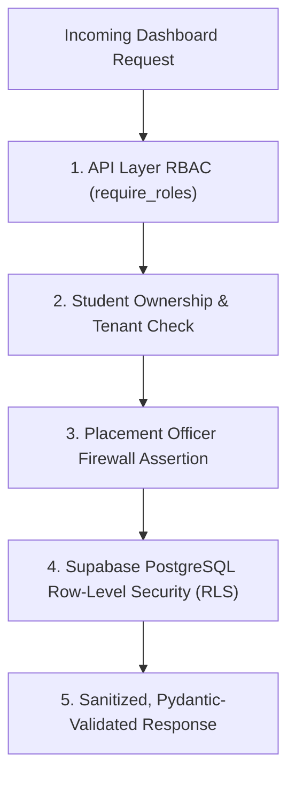

# MASTERY — Phase 10 Security & Privacy Verification
## Defense-in-Depth, Tenant Boundaries & Placement Officer Firewall

**Platform:** MASTERY — Beyond Marks. Towards Mastery.  
**Team:** VARY — SRUJAN 2026  
**Problem Statement:** AI-03 — Student Performance Prediction  
**Track:** AI, CyberSecurity and Digital Trust  
**Phase:** 10/11 — Unified Intelligence Dashboard & Cross-Module Integration  

---

## 1. Security Architecture & Threat Vectors

Because the unified dashboard layer aggregates intelligence from all seven business modules, it represents a high-value integration boundary. Security is maintained through defense-in-depth:

---

## 2. Verification of Critical Security Barriers

### 2.1 Placement Officer Firewall
- **Threat:** Employers or Placement Officers viewing students' internal academic risk predictions or confidential academic intervention notes to discriminate in recruitment.
- **Enforcement:**
  1. `_assert_not_placement_officer()` intercepts any Placement Officer attempting to access `/api/v1/dashboard/student/overview`, `/api/v1/dashboard/student/risk-summary`, or `/api/v1/dashboard/student/intervention-summary` with `HTTP 403 Forbidden`.
  2. The placement endpoint `/api/v1/dashboard/placement/overview` explicitly queries only `career_readiness_analyses`, `student_project_evidence`, and `career_skill_gap_findings`. Tables for risk predictions and intervention plans are entirely omitted from the query plans.
  3. **Verified in automated tests:** `test_placement_officer_dashboard_and_firewall` in `backend/tests/test_unified_dashboard.py` passed with 100% assertions satisfied.

### 2.2 Student Self-Ownership
- **Threat:** Students inspecting peer performance, learning gaps, or risk flags.
- **Enforcement:**
  - When `current_user.role == UserRole.STUDENT`, passing any `student_id` that does not match their own `profile_id` raises `HTTP 403 Forbidden`.
  - **Verified in automated tests:** `test_student_dashboard_overview_and_ownership` asserts that passing a peer student ID returns `403`.

### 2.3 Institution Tenancy Isolation
- **Threat:** Cross-institution data leakage between partner colleges or universities.
- **Enforcement:**
  - All queries for students, subjects, assessments, mastery results, risk predictions, and career analyses are strictly constrained by `institution_id = current_user.institution_id`.
  - `SUPER_ADMIN` is the only role permitted to query across institution boundaries.

### 2.4 Supabase Row-Level Security
- **Status:** **57 of 57 application tables have `rowsecurity = true`** in live Supabase PostgreSQL.
