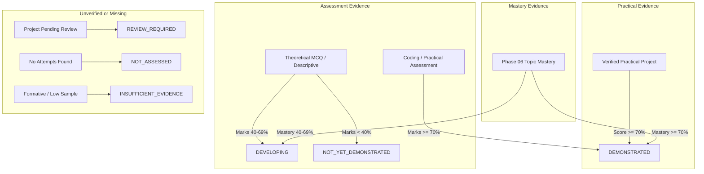

# MASTERY — Student Competency Evidence Engine
## Evidence Eligibility, Verification, and Classification Standards

**Platform:** MASTERY — Beyond Marks. Towards Mastery.  
**Module:** Module 08 — Career Readiness & Industry Skill Gap Intelligence  

---

## 1. Multi-Modal Evidence Hierarchy

MASTERY derives student competency standing from four distinct, validated evidentiary tiers:

---

## 2. Competency Evidence States

| Evidence State | Meaning & Qualification Criteria |
|---|---|
| **`DEMONSTRATED`** | Verified evidence meeting or exceeding the required depth threshold. Supported by continuous topic mastery $\ge 70\%$, evaluated practical assessments $\ge 70\%$, or a faculty-verified practical engineering project. |
| **`DEVELOPING`** | Meaningful evidence exists ($40\% - 69\%$), showing emerging capability, but proficiency does not yet satisfy the target benchmark depth. |
| **`NOT_YET_DEMONSTRATED`** | Assessments or assignments have been completed, but the observed score fell below $40\%$. |
| **`NOT_ASSESSED`** | No relevant evaluation, course assessment, or project submission has occurred. |
| **`INSUFFICIENT_EVIDENCE`** | Formative probe or single low-weight response exists, but sample size is inadequate to form a reliable conclusion. |
| **`REVIEW_REQUIRED`** | Student has submitted project or portfolio evidence that is awaiting faculty verification. |

> [!IMPORTANT]
> **The Non-Punitive Missing Evidence Rule:**  
> Missing evidence (`NOT_ASSESSED`) is NEVER conflated with failure or incompetence (`NOT_YET_DEMONSTRATED`). Students who have not yet taken an assessment are directed toward assessment opportunities rather than subjected to remedial labels.

---

## 3. Practical Project Verification Protocol

To prevent unverified GitHub URLs from claiming unearned competency standing, MASTERY implements a human-in-the-loop project verification workflow:

1. **Submission:** Student submits project title, architectural description, technology stack tags, repository URL, and declared demonstrated competencies. State is initialized as `PENDING_REVIEW`.
2. **Faculty Inspection:** Authorized faculty or lab mentors review repository commits, code quality, and execution artifacts.
3. **Verification Ledger Update:** Upon faculty approval (`VERIFIED`), `StudentCompetencyEvidence` records of type `PROJECT_DEMONSTRATION` are generated, establishing verified practical credit.
4. **Anti-Tampering:** Verified projects are locked from further student modification. Student self-approval is strictly forbidden.

---

## 4. Deduplication & Provenance Preservation

Where multiple evidence sources exist for the same competency (e.g. both a theoretical midterm and a verified capstone project), MASTERY:
- Prioritizes higher-quality practical verification (`PROJECT_DEMONSTRATION` > `TOPIC_MASTERY` > `THEORETICAL_ASSESSMENT`).
- Preserves full provenance in `provenance_details` (job IDs, assessment references, reviewer IDs, timestamps).
- Strictly prohibits double-counting the same underlying exam question across Phase 04 and Phase 06.
