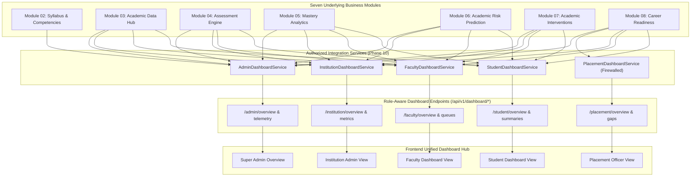

# MASTERY — Unified Intelligence Dashboard Architecture
## Phase 10/11 Architecture & Integration Specification

**Platform:** MASTERY — Beyond Marks. Towards Mastery.  
**Team:** VARY — SRUJAN 2026  
**Problem Statement:** AI-03 — Student Performance Prediction  
**Track:** AI, CyberSecurity and Digital Trust  
**Phase:** 10/11 — Unified Intelligence Dashboard & Cross-Module Integration  

---

## 1. Architectural Mission & Philosophy

Across Phases 03 to 09, seven dedicated business modules were engineered to address distinct facets of academic and career progression:
1. AI Syllabus & Competency Intelligence (Module 02)
2. Academic Data Intelligence Hub (Module 03)
3. Intelligent Assessment & Attentiveness Engine (Module 04)
4. Learning Mastery & Performance Analytics (Module 05)
5. Academic Risk Prediction Engine (Module 06)
6. Personalized Academic Intervention Engine (Module 07)
7. Career Readiness & Industry Skill Gap Intelligence (Module 08)

Phase 10 unifies these seven modules into a cohesive, role-aware academic intelligence platform without duplicating business logic, violating data provenance, or collapsing multidimensional insights into a simplistic, misleading composite score.

---

## 2. Core Architectural Guarantees

### 2.1 Non-Duplication of Business Logic
The dashboard integration layer operates strictly as an aggregation and presentation tier. It executes optimized SQL queries and calls module services to compile live profiles. It does not re-compute Bloom depths, run logistic regression models, alter intervention state transitions, or recalculate rubric scores.

### 2.2 Strict Non-Aggregation Policy
MASTERY categorically rejects single-number composite scoring (e.g. combining marks, mastery, risk, and career readiness into an arbitrary "87% Student Rating").
- Verified marks represent formal institutional academic evaluations.
- Topic mastery represents demonstrated conceptual understanding under assessment evidence.
- Academic risk represents time-bounded statistical vulnerability to future academic deficit.
- Intervention progress represents student engagement in targeted remediation.
- Career readiness represents multi-modal alignment against industry role frameworks.

### 2.3 Evidence Sufficiency & Missing Data Integrity
Missing evidence is never coerced to zero. When a student has not attempted assessments for a syllabus topic, the status is explicitly preserved as `NOT_ASSESSED` or `INSUFFICIENT_EVIDENCE`.

### 2.4 Placement Officer Firewall
Placement Officers are strictly prohibited from accessing Academic Risk Predictions (Module 06) and Confidential Academic Support Plans (Module 07). Both API-level middleware and database RLS ensure that requests by Placement Officers to restricted routes fail with `HTTP 403 Forbidden`.

---

## 3. Subsystem Breakdown

### 3.1 Student Intelligence Dashboard
- **Route:** `/` (default for students) or `/dashboard/student`
- **Scope:** Own student profile (`StudentAcademicProfile.profile_id == current_user.user_id`).
- **Cards:**
  1. Profile Header (Program, semester, department, enrollment number, academic status).
  2. Academic Records Card (Verified marks average, attendance %, record count, verification queue).
  3. Learning Mastery Card (Assessed topics count, demonstrated vs developing vs insufficient progress, CLO attainment rate, flagged learning gaps).
  4. Explainable Academic Risk Card (Classification badge, prediction horizon, primary adverse factors, protective factors, ethical scientific disclaimer).
  5. Personalized Academic Interventions Card (Active plans count, pending actions count, mentor identity, quick link to support plan).
  6. Career Readiness & Practical Projects Card (Target role, separate core and practical coverage bars, verified projects count, pending projects, active skill gaps).

### 3.2 Faculty Intelligence Dashboard
- **Route:** `/` (default for faculty) or `/dashboard/faculty`
- **Scope:** Institution-wide subjects and students assigned to the faculty member.
- **Components:**
  1. Actionable Verification Queues: Pending academic marks verification, pending intervention plan reviews, pending practical project reviews.
  2. Cohort Risk Overview: High risk, moderate risk, active interventions, and flagged learning gaps counts.
  3. Assigned Subjects Performance Matrix: Table detailing subject codes, enrolled counts, average attendance rates, and average marks.

### 3.3 Institution Admin Dashboard
- **Route:** `/` (default for institution admins) or `/dashboard/institution`
- **Scope:** Tenant-isolated institutional aggregate metrics.
- **Components:**
  1. Institutional Summary Counts: Active students, faculty, degree programs, subjects.
  2. Domain Integrity Quadrants:
     - Academic Data Health & Quality Findings
     - Learning Mastery Distribution
     - Academic Risk Distribution
     - Career Competency Alignment & Project Verifications
     - Support Plan Lifecycle Metrics

### 3.4 Placement Officer Workspace
- **Route:** `/` (default for placement officers) or `/dashboard/placement`
- **Scope:** Career frameworks, verified project portfolios, and industry skill gaps.
- **Firewall Guarantee:** Zero access to risk models or confidential faculty intervention notes.
- **Components:**
  1. Role Catalog & Evaluated Students Count.
  2. Alignment Distribution (Strong, Partial, Limited, Insufficient Evidence).
  3. Practical Project Verification Ledger.
  4. Top Industry Skill Gaps across student cohorts.

### 3.5 Super Admin Operational Telemetry
- **Route:** `/` (default for super admins) or `/dashboard/admin`
- **Scope:** Multi-tenant platform health and subsystem operational telemetry.
- **Components:**
  1. Multi-Tenant Counts: Total institutions, total registered user identities.
  2. Subsystem Matrix: Status checks for all eight business modules.
  3. Infrastructure Health: Database connection status, query latency in milliseconds, latest applied Alembic migration revision.
